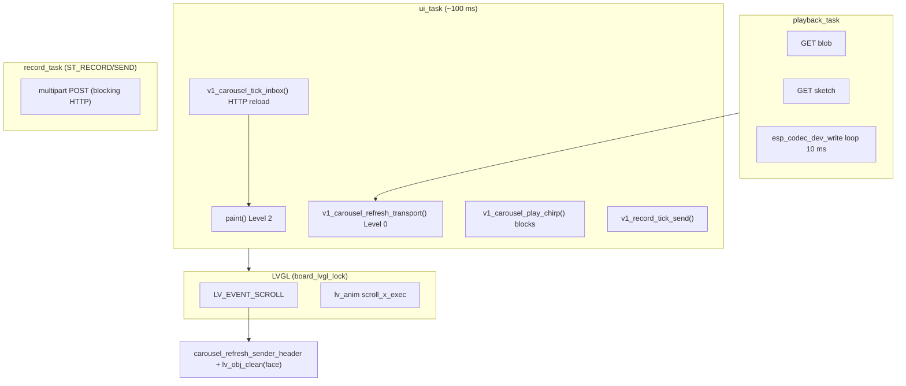
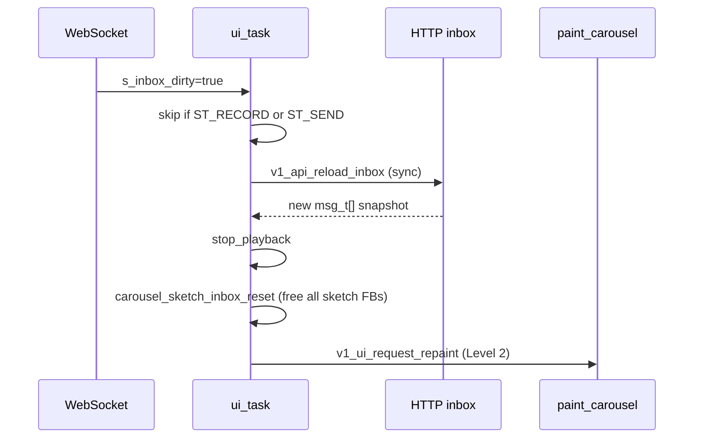
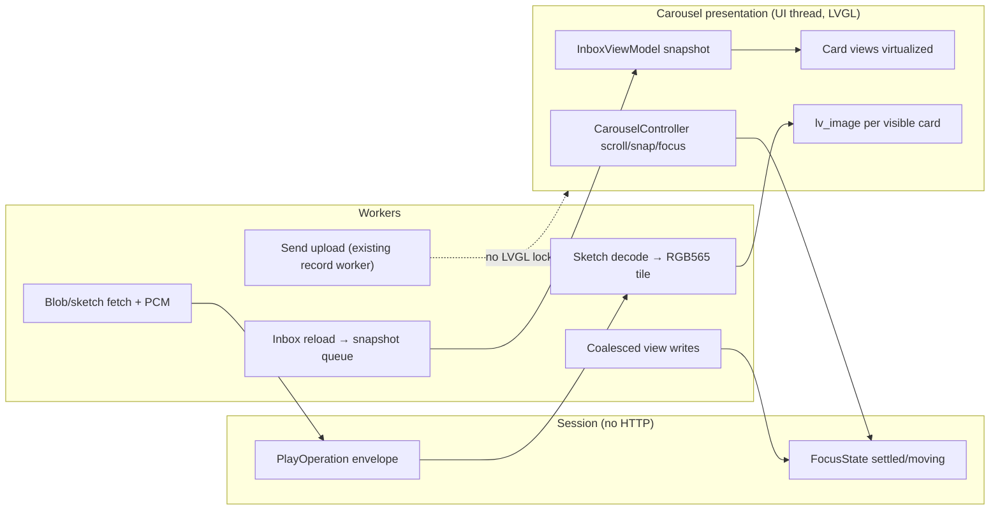

# LVGL assessment — v1 carousel module (inbox carousel + playback)

**Framework:** [`FOUNDATION-LVGL-BUDGET`](../foundations/FOUNDATION-LVGL-BUDGET.md)  
**Prior art:** [`carousel-playback`](../../../v1-assessments/carousel-playback.md), [`ui-update-taxonomy`](../../../v1-assessments/ui-update-taxonomy.md), [`async-operation-envelope`](../../../v1-assessments/async-operation-envelope.md), [`session-stage-vs-background-poller`](../../../v1-assessments/session-stage-vs-background-poller.md)  
**Pattern ledger:** `v1_carousel` — **AVOID** (patterns) with selective **ADOPT**  
**V2 targets:** [`COMP-USER-CARD`](../components/COMP-USER-CARD.md), inbox carousel panel (TBD), [`sketch-record-and-playback`](../../experiences/sketch-record-and-playback.md)

## Header

| Field | Value |
|---|---|
| **Assessment ID** | `ASSESS-MODULE-v1-carousel` |
| **Scope** | Legacy v1 product module: horizontal inbox carousel, transport, audio playback, card sketch replay, settings cards |
| **Revision** | 0.1 |
| **Status** | Draft — static source analysis (not re-tested on device in this pass) |
| **Date** | 2026-10-11 |
| **Firmware ref** | Legacy v1 POC archive — `v1_carousel` + `x02` `ui_task` integration |

---

## 1. Why this document exists

You want to **re-create the carousel as a reusable v2 component** that can:

1. **Keep animating** (snap, scroll, opa peeks) while **upload and other I/O** run in the background.
2. **Reveal sketches** on incoming messages (timed ink on the card), not only during full audio playback.

This assessment maps **what v1 actually does**, where it blocks the UI thread, and what a v2 component must separate to meet those goals.

---

## 2. User-visible scope (v1)

| Stage | Behavior |
|---|---|
| **Browsing** | Up to `V1_MSG_MAX` (16) message cards in a horizontal scroller; center card focused; side cards at 50% opacity; sender header (prefix, face, name); play control |
| **Snap** | Programmatic scroll animation after fling or card tap; duration scales with distance (`V1_CAROUSEL_SNAP_MS_MIN` + delta) |
| **Playback** | Dedicated FreeRTOS task fetches WAV blob + optional sketch; drives codec; updates `s_play_pos_ms` |
| **Sketch on card** | FLSK points fetched once per play; rasterized into per-card RGB565 buffer; time-synced to audio position |
| **Inbox refresh** | WebSocket sets `s_inbox_dirty`; `ui_task` reloads inbox via HTTP; **full carousel repaint** |
| **Settings** | Reuses same carousel machinery with different card count and modal on tap |

Entry/exit: sign-in → carousel; shoulder → settings; circle → record flow (leaves carousel).

---

## 3. Runtime topology (tasks, locks, ticks)



| Integration point | Period / trigger | Holds `board_lvgl_lock`? |
|---|---|---|
| `ui_task` loop | **100 ms** | Yes, during `paint` / `refresh_transport` |
| `v1_carousel_refresh_transport` | When `is_playing` **or** `transport_dirty` | Yes |
| `v1_carousel_tick_inbox` | Each `ui_task` iteration when dirty | Reload runs **outside** lock; then `request_repaint` |
| `playback_task` | ~10 ms PCM chunks | No LVGL lock; sets `s_play_pos_ms`; end calls `request_transport_refresh` |
| `v1_record_tick_send` | Same `ui_task` | Only on `ST_SEND` (send receipt screen), not carousel |

**Upload vs carousel (v1):** Outbound upload runs on **`record_task`** while stage is **`ST_RECORD` / `ST_SEND`**. The carousel tree is **not on screen** during upload. Inbox WS events are **deferred** (`s_inbox_dirty` stays true) until stage returns to carousel/settings — see §6.

**Implication for your v2 goal:** v1 never tried “carousel visible + outbound upload.” Any v2 design that keeps the inbox on screen during send must **not** copy v1’s stage model without a new presentation contract.

---

## 4. LVGL object model and memory

### 4.1 Scene construction (`paint_carousel`)

- **`lv_obj_clean(scr)`** then rebuild: ribbons, sender row, horizontal `s_carousel_scroll`, **N cards** (`carousel_add_card`), spacer, play button, hidden scrub bar.
- **Per message card:** gradient `lv_obj`, portrait (image or geometry face), unread dot, duration label; optional `sketch_img` reattached if slot already has FB.
- **Eager N:** `n = s_inbox_n` up to **16** — not virtualized.

| Ledger | v1 as-built (order of magnitude) |
|---|---|
| **A — LVGL pool** | ~110–130 widgets at max inbox; spikes on every full paint |
| **B — sketch** | Up to **16 × ~35 KiB** ≈ **552 KiB** if every slot allocates (`132×134×2`) |
| **B — playback** | **~320 KiB** `playback_buf` (config) on PSRAM |
| **B — draw strip** | BSP **320×100×2** ≈ **62.5 KiB** (separate from LVGL pool) |

### 4.2 Persistent vs ephemeral handles

- `s_carousel_ui_live` + scroll X restore: avoids UAF when repaint happens **on same stage** with live tree.
- `v1_carousel_invalidate_ui()`: nulls module pointers when **another stage** destroyed the screen.

---

## 5. Animation and input paths

### 5.1 What animates smoothly (when nothing blocks)

| Motion | Mechanism | Level |
|---|---|---|
| Horizontal snap | `lv_anim` → `scroll_x_exec` → `lv_obj_scroll_to_x` | **0** on scroller |
| Opacity peeks | `lv_obj_set_style_opa` on cards during scroll / focus | **0** |
| Playback bar/clock (if shown) | `ui_refresh_transport` | **0** |
| Sketch stroke replay | `card_sketch_apply_until` + `lv_obj_invalidate(sketch_img)` | **0** on image widget |

Snap uses `s_scroll_lock` to suppress recursive `SCROLL_END` → `sync_focus_from_scroll` during programmatic move.

### 5.2 What stalls animation (critical for v2)

| Blocker | Where | Effect |
|---|---|---|
| **Sync HTTP** `PUT /v1/session/view` | `sync_focus_from_scroll`, `on_carousel_card_click`, `shift_focus_to`, inbox autoplay branch | **UI thread waits** on network during/after scroll |
| **`stop_playback()` spin** | Any focus change; chirp; inbox reload | `while (s_playing) vTaskDelay(20)` — can run on thread that holds LVGL lock |
| **`play_chirp()`** | `ui_task` when not playing | `stop_playback` + `esp_codec_dev_open/write` on UI path |
| **Full `paint_carousel`** | After inbox reload | Destroys scroller; **kills in-flight scroll anim**; reallocates all cards |
| **Sender portrait rebuild** | `refresh_card_visuals_from_scroll` → `carousel_refresh_sender_header` → **`lv_obj_clean(s_sender_face)`** every `LV_EVENT_SCROLL` | Widget churn during kinetic scroll |

```text
SCROLL event
  -> refresh_card_visuals_from_scroll (opa on all N cards)
  -> carousel_refresh_sender_header
       -> lv_obj_clean(s_sender_face)
       -> v1_ui_paint_user_portrait_aligned(...)  // 3–4 new objects
```

**v2 component MUST NOT** port the scroll-time portrait rebuild.

---

## 6. Background work: inbox, upload, playback

### 6.1 Inbox refresh sequence (v1)



- Focus preserved by **message seq** when possible.
- **Autoplay-new:** if armed, focuses last message, sync view write, may set `s_want_play`.
- **Sketch state:** wiped on every successful reload — no incremental “draw in new message sketch” on arrival.

### 6.2 Upload (v1) vs carousel visibility

| Phase | Stage | Carousel visible? | Inbox WS |
|---|---|---|---|
| Recording | `ST_RECORD` | No | Deferred |
| Upload / receipt | `ST_SEND` | No | Deferred |
| Signed-in | `ST_CAROUSEL` | Yes | Processed |

Upload HTTP is **blocking inside `record_task`**, not interleaved with carousel LVGL. Returning to carousel after send uses **Level 2** `paint()` for send screen teardown then carousel paint.

**For v2 “animate during upload”:** require explicit product choice:

- **A.** Stay on carousel; show non-blocking send progress (toast / ribbon) — **new**; inbox may still refresh.
- **B.** Overlay send progress on carousel without `lv_obj_clean` — **Level 0/1** chrome only.
- **C.** Keep v1 stage split (no carousel during upload) — **no animation requirement** on carousel during upload.

### 6.3 Playback + sketch timing

| Clock | Source | UI update rate |
|---|---|---|
| Audio | `playback_task` ~10 ms PCM | `s_play_pos_ms` updated in worker |
| Transport + sketch | `ui_task` when `is_playing` | **`refresh_transport` ~100 ms** → `carousel_sketch_tick` |

Sketch fetch: **synchronous HTTP on playback task** at play start (`http_sketch_get`). Points stored in static `s_sketch_blob`; replay uses `sketch_map_xy` from **full LCD coordinates** to **card buffer** (not SK-002 120×120 logical).

**Incoming message sketch without play:** v1 does **not** animate sketch on card when a new message arrives; user must play (or card shows portrait only until sketch slot populated on play).

---

## 7. Update level map (v1 as-built)

| User-visible change | v1 level | v2 target |
|---|---|---|
| Scroll / opa peeks | 0 | **Keep 0** |
| Snap animation | 0 | **Keep 0**; disable card hit tests while snapping (see roster panel) |
| Transport during play | 0 | **ADOPT** (h18 pattern) |
| Sender name / read badge | 0 | **Keep 0** |
| Inbox WS → new messages | **2** (full paint) | **1** diff by message seq |
| Focus change | 0 local + **sync HTTP** | **0** local; view write **async coalesced** |
| Sketch replay frame | 0 invalidate image | **0**; optional dirty-rect later |
| Enter/leave carousel stage | 2 | 2 OK at stage boundary only |

---

## 8. Sketch pipeline (v1) vs v2 experience

| Step | v1 | v2 (`sketch-record-and-playback`) |
|---|---|---|
| Storage coords | Full-screen logical in FLSK | **120×120** logical |
| Card replay | **132×134** FB, map from screen coords | **120×120** centered in card, **1:1** |
| Ink color | Single `CARD_SKETCH_INK_HEX` | Multi-color FLSK2 (TBD) |
| Reveal on arrival | No — reset on inbox reload | **Product ask:** progressive reveal on new `has_sketch` without full play? |
| CPU cost | `card_sketch_apply_until` may replay thousands of points in one `refresh_transport` tick | Cap points/frame; decode off UI thread |

**v2 component recommendation:** treat **sketch decode + raster** as a **service** feeding `lv_image` descriptors per card, not logic inside carousel scroll handlers.

---

## 9. Standard measurement table (v1 baseline → v2 budget)

| Column | v1 as-built | v2 component target (draft) |
|---|---|---|
| Widgets steady (max inbox) | ~110–130 | ≤ **3 live cards** + chrome (**virtualize**) |
| Widgets peak | Full paint + scroll face rebuild | No portrait rebuild on scroll |
| Ledger A | Often **30–35%** of 64 KiB pool at N=16 | ≤ **25%** steady; spike only on stage enter |
| Ledger B sketch | Up to **16 × 35 KiB** | **1 playing + 1–2 decoded** @ **28 KiB** (120×120) |
| Invalidate | Whole card sketch image | Card sketch image; later sub-rect |
| Paint lifecycle | Full clean on inbox | **Level 1** collection diff |
| Anim during upload | N/A (off carousel) | Snap/scroll **must not** call sync HTTP or `stop_playback` spin on UI thread |
| Sketch on new message | Only after play + fetch | **OPEN:** preview reveal policy |
| p95 snap frame time | Not logged | **Measure** on device; gate &lt; 33 ms target TBD |

---

## 10. Anti-patterns — do not port to v2 component

1. **`lv_obj_clean(scr)` on inbox notification** while carousel stage remains active.
2. **Synchronous session/view HTTP** from scroll end, card click, or focus sync.
3. **`lv_obj_clean(s_sender_face)` on every horizontal scroll event.**
4. **Materializing all `V1_MSG_MAX` cards** regardless of viewport.
5. **`stop_playback()` busy-wait** from paths that may hold `board_lvgl_lock`.
6. **`play_chirp()` blocking codec I/O** on `ui_task`.
7. **Playback operation identity** tied to mutable `s_inbox_focus` without envelope (stale completion risk).
8. **Sketch coordinate rescaling** from full-screen space — contradicts SK-002–004.

---

## 11. Recommended v2 component architecture

Split the monolith into layers (names are illustrative; map to `PANEL-*` / `COMP-*`):



| Module responsibility | Owns | Must not own |
|---|---|---|
| **CarouselController** | scroller, snap anim, opa, pointer lock during snap | HTTP, codec, sketch bytes |
| **InboxSnapshot** | immutable `msg_t` list + diff | LVGL widgets |
| **PlayOperationWorker** | fetch, play, cancel, stale detection | focus index at completion |
| **SketchRasterCache** | decode FLSK → card FB, evict LRU | scroll event handlers |
| **TransportBinder** | bar, clock, play icon — Level 0 | full paint |

**Concurrency rules for your goals:**

- **Animate during upload:** `UploadWorker` never calls `paint()` or takes `board_lvgl_lock`. Carousel only subscribes to **optional** `SendProgress` events (Level 0 label).
- **Sketch on incoming message:** on snapshot diff, enqueue `SketchJob(message_seq)`; when raster ready, **Level 1** attach/update `sketch_img` on that card only; optional **timed reveal** uses same clock as preview play, not audio.

---

## 12. Reuse map: v1 → v2 component

| v1 artifact | Reuse in v2 |
|---|---|
| Horizontal scroller + snap target math | **ADOPT** — align with `PANEL-BODY-ROSTER-CAROUSEL` / p13 lab |
| `scroll_x_exec` + `s_scroll_lock` | **ADOPT** |
| Opacity peeks on non-focused cards | **ADOPT** |
| `ui_refresh_transport` during play | **ADOPT** (h18 + carousel) |
| `paint_carousel` full rebuild | **REPLACE** with Level 1 diff |
| `carousel_sketch_*` in same file | **EXTRACT** to sketch service; fix coordinate system |
| `tick_inbox` + repaint | **REPLACE** with snapshot queue + diff |
| Settings cards in same module | **SPLIT** — separate panel or mode flag with shared `CarouselController` |

---

## 13. Verification scenarios (v2 component)

| ID | Scenario | Pass |
|---|---|---|
| CAR-01 | Snap animation p95 &lt; 33 ms while view write delayed 2 s | No scroll stall; focus settles locally |
| CAR-02 | WS inbox event during snap | Snap completes; diff applied after; no UAF |
| CAR-03 | Upload progress on carousel (if product chooses A/B) | Snap/scroll continue; no full paint |
| CAR-04 | New message with sketch arrives | Card shows sketch per policy without stopping playback on **other** card |
| CAR-05 | Play message A; focus change to B mid-play | Operation A **cancelled**; B play starts clean |
| CAR-06 | 16-message inbox | Only ≤3 card subtrees live; heap within envelope |
| CAR-07 | Offline | Carousel usable; toasts; no blocking HTTP on scroll |

---

## 14. Recommendations (priority)

| P | Action |
|---|---|
| **P0** | Specify v2 product rule for **carousel visible during send** (§6.2 A/B/C) before implementation. |
| **P0** | Implement **CarouselController** + **InboxSnapshot diff**; ban inbox `lv_obj_clean` on WS. |
| **P0** | Move view/read/position writes to **coalesced worker**; scroll end updates focus only. |
| **P1** | **SketchRasterCache** with SK-002–004 geometry; async fetch on play and optional on arrive. |
| **P1** | **PlayOperation** envelope per async assessment. |
| **P2** | Chirp queue on audio worker, never on `ui_task`. |
| **P2** | Author `COMP-INBOX-CAROUSEL` (or extend `COMP-USER-CARD` message variant) from §11. |

---

## 15. Sign-off

| Role | Name | Date | Notes |
|---|---|---|---|
| Product owner | | | Upload-on-carousel policy; sketch-on-arrive policy |
| Implementer | | | |
| Reviewer | | | |

## Revision history

| Rev | Date | Change |
|---|---|---|
| 0.1 | 2026-10-11 | Initial deep module assessment for v2 carousel re-creation |
