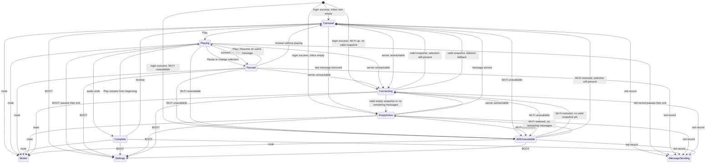

# Message carousel and playback experience

Status: interview draft — reconstruction, ordinary-flow, exception, and contract checkpoints reviewed 2026-10-21
Experience ID: EXP-MESSAGE-CAROUSEL
Revision: 0.9
Owner: Product owner
Approval: Contract checkpoint confirmed 2026-10-21 for the recorded locked behavior. No product-wide approval claimed; no implementation authorization implied

## 1. Identity, scope, and authority

This hardware-mediated, continuous, and informational experience is **only for
a signed-in user**. It starts when server-confirmed endpoint login enters the
main message screen. It covers browsing a horizontally navigable message
carousel, selecting a message by stable identity, reporting that selection to
the server, and playing the selected message's audio with optional
synchronized sketch animation.

Recipient selection, recording/sketching, sending, and settings behavior
are out of scope. This specification defines two signed-in exits from the
carousel: physical BOOT to a separate settings experience, and the
physical off-screen red recording button to a separate message-sending
sequence. It does not specify those destination experiences. Physical
mute/unmute remains the related sign-out/display invariant already decided
in [`EXP-LOGIN`](endpoint-login.md); this specification does not redesign
mute.

`MUST` expresses a requirement only after its decision is accepted. V1
carousel, inbox, and playback evidence is historical and does not establish v2
policy unless the owner adopts a specific statement.

### Sources

| ID | Source and authority | Relevant material |
|---|---|---|
| SRC-OWNER-001 | Product owner, 2026-10-21 interview brief | Split-panel carousel layout; selection identity and reporting; new-message and deletion rules; playback/pause/resume; sketch synchronization; connectivity reuse |
| SRC-OWNER-002 | Product owner, 2026-10-21 reconstruction checkpoint | Signed-in-only scope; inherit mute, lower-slot connectivity, and 120×120 sketch; first-entry last-viewed-or-newest without autoplay |
| SRC-OWNER-003 | Product owner, 2026-10-21 ordinary-flow interview | Oldest-left timeline; tap selects only; deletion fallback to older neighbor |
| SRC-OWNER-004 | Product owner, 2026-10-21 continuity interview | Same-session pause/sketch persist; mute resets play heads; last-viewed only is server-synced |
| SRC-OWNER-005 | Product owner, 2026-10-21 exception interview | Mid-play connectivity pauses immediately; header shows disabled Play; deletion during outage uses the usual fallback |
| SRC-OWNER-006 | Product owner, 2026-10-21 exception interview | Play-start and mid-play audio failures show `can't play`; sketch-only faults do not abort audio |
| SRC-OWNER-007 | Product owner, 2026-10-21 ordinary-flow interview | Empty copy `Messages` / `No messages`; full current inbox reachable; BOOT exits to settings |
| SRC-OWNER-008 | Product owner, 2026-10-21 contract-checkpoint amendment | Red recording button pauses playback and exits to the message-sending sequence |
| SRC-EXP-LOGIN-001 | Active experience draft; owner-decided for login | [`EXP-LOGIN`](endpoint-login.md): successful authentication enters the signed-in message carousel (`DEC-010`, `EXP-012`); mute signs out and blanks the display; lower-slot `connecting` / `no Wi-Fi` presentation (`DEC-051`–`DEC-052`, `DEC-060`, `EXP-037`) |
| SRC-EXP-SKETCH-001 | Active experience; owner-decided canvas geometry | [`EXP-SKETCH-RECORD-PLAYBACK`](sketch-record-and-playback.md): 120×120 logical sketch framed inside the message card; audio is the sketch clock; audio-only messages have no sketch |
| SRC-V1-CAR-001 | Active v1 assessment; implementation evidence only | [Carousel and playback assessment](../../v1-assessments/carousel-playback.md): browsing, snap, playback, inbox refresh; open v1 product decisions on failure copy, offline blobs, autoplay-new, and scrub |
| SRC-COM-INBOX-001 | Proposed v2 communication contract; not approved | [Inbox, media, and playback-state](../communication-contracts/inbox-and-media.md): server-owned inbox and persisted playback state; client-owned focus and active playback; `COM-OPEN-002`–`COM-OPEN-005` |
| SRC-UI-001 | Supporting concept guide | [UI update taxonomy](../../v1-assessments/ui-update-taxonomy.md): inbox membership is a Level 1 identity-keyed update; playback progress is Level 0 |
| SRC-UI-SPLIT-001 | Active device-UI draft | [`LAYOUT-SPLIT-PANE`](../device-ui/layouts/LAYOUT-SPLIT-PANE.md); [`PANEL-STATUS-MESSAGE`](../device-ui/panels/PANEL-STATUS-MESSAGE.md); [`FOUNDATION-MOTION`](../device-ui/foundations/FOUNDATION-MOTION.md) |
| SRC-STD-001 | Normative engineering standard, not product policy | [Client application coding standards](../../standards/client-application-coding-standards.md) §§3–5, 7, 9: identity-bound async results, update levels, failure contracts, coalesced remote writes |
| SRC-LAB-001 | Supporting lab plan; not product policy | [Inbox carousel playback evaluation](../../labs/inbox-carousel-playback-evaluation.md): paging, pause/resume, and resource questions still need measurement |

**Source conflicts and applicability (reconstruction-confirmed):**

1. The owner forbids audio scrubbing. V1's hidden scrub control is not a v2
   requirement (`DEC-010`).
2. New messages must not change selection or position. Connectivity recovery
   and first entry after login must not autoplay (`DEC-005`, `DEC-015`,
   `DEC-018`). V1's autoplay-new OPEN item is not adopted.
3. The owner requires reporting current selection to the server. Pause
   position and sketch progress are **not** server facts in this experience
   (`DEC-028`). The proposed inbox `position_ms` write is not adopted here.
4. Mute-on signs the user out (`DEC-016`). Login is controlling.
5. Sketch replay uses the existing 120×120 card-framed canvas (`DEC-017`).
6. Selection uses stable message identity, not v1 recipient sequence.
   Timeline order is oldest left, newest right (`DEC-022`). Every message
   currently in the server inbox is reachable by swiping (`DEC-037`).
7. Signed-in connecting copy uses the established login presentation:
   `connecting` with three progressive dots, and `no Wi-Fi`. The interview
   brief's `connecting...` is treated as that same status, not a new string
   (`DEC-014`).

### Revision history

| Rev | Date | Change |
|---|---|---|
| 0.1 | 2026-10-21 | Reconstruction draft from the owner's carousel and playback brief. |
| 0.2 | 2026-10-21 | Reconstruction checkpoint confirmed. Locked signed-in-only scope, inherited mute/connectivity/sketch, and last-viewed-or-newest first entry without autoplay. |
| 0.3 | 2026-10-21 | Locked oldest-left timeline, header-only Play/Pause, and older-neighbor deletion fallback. |
| 0.4 | 2026-10-21 | Locked same-session pause/sketch persistence, mute reset, and last-viewed-only server sync. |
| 0.5 | 2026-10-21 | Locked mid-play pause on connectivity loss, disabled header Play during status, and outage deletion fallback. |
| 0.6 | 2026-10-21 | Locked `can't play` for audio start/mid-play failures; sketch-only faults keep audio going. |
| 0.7 | 2026-10-21 | Locked empty-inbox copy, full-inbox reach, and BOOT-to-settings exit. |
| 0.8 | 2026-10-21 | Recorded the red recording button as a defined exit to the message-sending sequence. |
| 0.9 | 2026-10-21 | Contract checkpoint confirmed. No implementation authorization. |

## 2. Scenario and intended experience

### Original owner input

The owner supplied the following brief on 2026-10-21. It is preserved here as
the starting product statement, not as an approved specification.

> After a user completes endpoint login they transition to the main message
> screen.
>
> Design the message carousel and playback experience using the existing
> split-panel layout.
>
> **Layout.** Upper third: Displays `From [sender name]` for the selected
> message, with a contextual Play/Pause action button on the right. Lower
> two-thirds: Displays a horizontally navigable carousel of message cards.
> Users can swipe or tap message cards to move through their message timeline.
>
> **Selection and synchronization.** Track the currently selected message by
> its stable identity and report that selection to the server. New messages
> are added to the carousel without changing the current selection or moving
> the user's position. If the selected message is deleted, move the selection
> to an appropriate remaining message. Changing the selected message pauses
> playback of the previous message.
>
> **Audio and sketch playback.** Each message contains audio and may include
> an accompanying sketch. When audio playback starts, the sketch progressively
> draws onto the message card, synchronized with playback. Audio cannot be
> scrubbed. Playback supports starting, pausing, and resuming. Pausing through
> the action button or changing messages preserves the current audio position
> and sketch progress. While paused, the message card continues displaying the
> partially completed sketch. When playback finishes, the card retains the
> fully rendered sketch. Replaying a completed message restarts both audio and
> sketch animation from the beginning.
>
> **Connectivity states.** Reuse the established split-panel connectivity
> behavior. When connecting or Wi-Fi is unavailable, replace the lower message
> carousel with centered `connecting...` or `no Wi-Fi` status content.
> Preserve the upper panel where appropriate, and disable unavailable playback
> actions. Restore the carousel and previous selection when connectivity
> recovers, without automatically restarting playback.
>
> Interview goals: resolve remaining decisions around carousel navigation,
> selection persistence, playback state transitions, sketch synchronization,
> deletion handling, message arrival, and connection recovery. Preserve the
> established application architecture and connectivity conventions.

### Reconstruction (confirmed 2026-10-21)

- **Person:** A hangout member who is signed in at a shared desk endpoint.
- **Setting:** The same always-on Family Link endpoint used for login: 320 ×
  240 landscape touch display, split-panel shell, swipe and tap. Physical mute
  blanks the display and signs the user out. English only.
- **Goal:** Find a message in their timeline, see who it is from, and play its
  audio. If the sender drew while talking, watch that sketch appear on the
  card in time with the audio.
- **Start:** Server-confirmed authentication from `EXP-LOGIN` enters this
  screen. Recipient selection, recording/sketching, sending, and settings
  are later experiences. This screen defines only the BOOT and red-button
  exits to those experiences.
- **First frame:** If the inbox has messages, select the server's last-viewed
  message when it is still present; otherwise select the newest message. Do
  not autoplay. If the inbox is empty, show no cards, do not show a sender
  name, and hide Play.
- **Ordinary flow:** The person sees a selected message's sender in the upper
  third and a Play action. The lower third shows message cards. They swipe or
  tap to change selection. Play starts audio; an accompanying sketch draws in
  sync. Pause or changing cards keeps the previous message's audio position
  and partial sketch. Finishing leaves the completed sketch on the card.
  Replay starts both from the beginning. Incoming messages join the carousel
  without stealing selection. Lost connectivity replaces the carousel with
  the established status body and disables Play; recovery restores the
  carousel and prior selection without auto-playing.
- **Completion:** There is no single terminal success. The person is finished
  with a message when they have heard it, or they may leave it paused or
  unplayed. The experience ends when mute signs them out, or when a later
  experience takes them off this screen.
- **Intended qualities, translated to observable behavior:** The person's
  place in the timeline stays put unless they move it or the selected message
  disappears. Playback is start / pause / resume / replay-from-start, never
  scrub. Drawing is a timed accompaniment to audio, not a separate viewer.
  Connectivity uses the same lower-slot language as login.

## 3. Physical and interaction context

- Display and shell: [`LAYOUT-SPLIT-PANE`](../device-ui/layouts/LAYOUT-SPLIT-PANE.md)
  — upper 80 px, lower 160 px.
- Upper content: `From [sender name]` on the left for the selected message;
  contextual Play/Pause on the right. Visual composition is later device-UI
  work; this specification owns the copy roles and when the action is
  available.
- Lower content: horizontally navigable message cards, oldest on the left and
  newest on the right. Swipe or tap selects and centers a card. Card gestures
  never start audio. Play and Pause live only in the header action.
- Sketch on a card reuses the owner-decided 120×120 framed canvas from
  `EXP-SKETCH-RECORD-PLAYBACK` (`DEC-017`).
- Connectivity presentation reuses [`PANEL-STATUS-MESSAGE`](../device-ui/panels/PANEL-STATUS-MESSAGE.md)
  and the login 150–200 ms lower-slot crossfade. Copy is `connecting` with
  three progressive dots, or `no Wi-Fi`. No overlay card and no dim.
- Accessibility, localization, and color-blind extras follow login: button
  sizing and visual/audio feedback; screen-reader and touch-less-display
  support are not required; English only.
- Physical BOOT, while signed in on this screen, leaves for settings
  (`DEC-038`). The physical off-screen red recording button leaves for the
  message-sending sequence (`DEC-039`). Mute still signs out.
- V1 ESP32-S3-BOX-3 facts remain historical device evidence, not automatically
  confirmed v2 hardware constraints.

## 4. Experience model and ordinary journey

| Stage | Entry | Exit | Primary actions | Surviving work |
|---|---|---|---|---|
| Message carousel | Signed-in; inbox reachable and non-empty; not playing | Header Play; swipe/tap changes selection in place; selected message deleted; inbox becomes empty; server unavailable; Wi-Fi unavailable; BOOT; red record; mute | Swipe or tap to select/center; header Play; BOOT; red record; mute | Selected message identity; reported last-viewed; per-message pause/complete sketch state for this signed-in session only |
| Playing | Play on a settled selected message | Pause; playback finishes; selection changes (pauses previous); connectivity loss (pauses immediately); BOOT; red record; mute | Pause; swipe/tap (pauses previous); BOOT; red record; mute | Active play operation bound to that message ID; audio position; sketch progress |
| Paused | Pause, selection change away from a playing message, or connectivity loss during play | Resume on that same selected message when the carousel is showing; Play after returning to it; replay-from-start if it had completed; BOOT; red record; mute | Play/Resume when carousel is showing; swipe/tap; BOOT; red record; mute | Preserved audio position and partial sketch on that message |
| Connecting | Signed in; Wi-Fi available; no valid signed-in server response | Valid inbox snapshot; Wi-Fi unavailable; BOOT; red record; mute | Observe `connecting`; BOOT; red record; mute | Previous selection retained and treated as paused if it had been playing; Play disabled; playback not automatically restarted |
| Wi-Fi unavailable | Signed in; Wi-Fi connection unavailable | Wi-Fi returns; BOOT; red record; mute | Observe `no Wi-Fi`; BOOT; red record; mute | Previous selection retained and treated as paused if it had been playing; Play disabled; playback not automatically restarted |
| Playback complete | Audio reaches the end on the selected message | Play (restarts from the beginning); selection change; BOOT; red record; mute | Play (replay); swipe/tap; BOOT; red record; mute | Fully rendered sketch remains on the card |
| Empty inbox | Signed-in; reachable inbox contains no messages | A message arrives; server unavailable; Wi-Fi unavailable; BOOT; red record; mute | Observe `Messages` / `No messages`; BOOT; red record; mute | No selection; Play hidden |
| Settings (exit) | Physical BOOT while signed in | Owned by the separate settings experience | — | If audio was playing, it is paused. Same-session play heads remain. This spec does not define the settings screen |
| Message sending (exit) | Physical red recording button while signed in | Owned by the separate message-sending experience | — | If audio was playing, it is paused and sketch progress is kept. Same-session play heads remain. This spec does not define recipient selection, record, or send confirmation |
| Muted | Physical mute latch is on | Latch switches off into `EXP-LOGIN` | Display off | No user session. Last-viewed remains a server fact. Play heads and sketches from this session are discarded |

Ordinary flow: after server-confirmed authentication, the endpoint shows the
signed-in split-panel message screen. Cards run oldest on the left and newest
on the right. If a valid inbox snapshot contains messages, it selects the
last-viewed message when that identity is still present and centers it; otherwise
it selects the newest (rightmost) message. It reports that selection and does
not start audio. The upper heading is `From [sender name]`. The lower slot
shows the message carousel. The person swipes or taps a card to select and
center it; those gestures never start audio. Header Play starts audio on the
selected message; an accompanying sketch draws onto that card in time with the
audio. Pause keeps the audio position and partial sketch. Changing selection
pauses the previous message and keeps its position. When audio ends, the card
keeps the completed sketch; header Play on that completed message restarts
both from the beginning. New messages join on the right without moving the
current selection or viewport. If the selected message is deleted, selection
moves to the nearest older (left) neighbor, or the next newer (right) neighbor
if it was oldest, or empty inbox if none remain. The new identity is reported
and does not autoplay. Within this signed-in session, returning to a paused
card keeps its audio position and partial sketch; returning to a completed
card keeps the full sketch and Play restarts from the beginning. Mute signs
the user out, turns the display off, and discards play heads and sketches.
The next login can restore last-viewed selection only; cards look unplayed.
If audio is playing when connectivity is lost, playback pauses immediately
and the lower slot shows status. The header keeps the sender and shows
disabled Play. Recovery restores the carousel and the previous selection if
it still exists, still paused, without autoplay. If that message was deleted
during the outage, the usual deletion fallback applies.
Every message currently in the server inbox is reachable by swiping; new
messages still join on the right without moving the current card. An empty
reachable inbox shows `Messages` above centered `No messages`. The first
arriving message becomes selected and does not autoplay. Physical BOOT
pauses playing audio if needed and leaves this experience for settings.
The physical red recording button pauses playing audio if needed, keeps
that message's position and sketch progress, and leaves this experience
for the message-sending sequence. Mute still signs the user out.

## 5. Stage and operation contracts

### Related mute interruption

- Switching mute on while signed in logs out the user, turns off the display,
  and leaves the endpoint powered (`DEC-016`, `EXP-LOGIN` `DEC-002`).
- This experience must not remain signed in after mute. Late playback or
  inbox results from the muted session must not restore audio or selection
  (`EXP-021`).
- Mute discards this session's play heads, partial sketches, and completed
  sketches (`DEC-027`). The next sign-in of the same user may restore
  last-viewed selection only. Cards appear unplayed. Play starts from the
  beginning.

### Connection status in the lower panel

- Reuse login presentation (`DEC-014`): `connecting` and `no Wi-Fi` replace
  the lower two-thirds. Keep the split layout and the current upper panel
  where a selected sender still applies. Do not use an overlay card and do
  not dim the background. Use a 150–200 ms crossfade. Rapid flaps must not
  flicker. The anti-flicker hold remains delegated to engineering.
- Connecting copy is `connecting` with three progressive dots and no icon.
  Wi-Fi copy is `no Wi-Fi` with no icon.
- If audio is playing when the lower slot is replaced, pause immediately.
  Keep that message's audio position and partial sketch. Do not continue
  from a buffer (`DEC-029`).
- Keep `From [sender name]` while a message remains selected. Show the
  header Play action in its disabled state. Do not show Pause, because
  playback is already paused. Play becomes available again only after the
  carousel returns (`DEC-030`).
- Do not automatically restart playback when the carousel returns
  (`DEC-015`). If the selected identity is still present, restore it paused
  where it left off. If it was deleted during the outage, apply the usual
  deletion fallback and report the new identity (`DEC-031`).
- While signed-in connecting is showing, reuse the login connecting request
  timeout and waits: 3-second request timeout, then waits of 1, 2, 4, and
  30 seconds (`DEC-032`, inherited from `EXP-LOGIN`).

### Message carousel and selection

- Selection is the stable message identity of one inbox item (`DEC-004`).
- Cards are ordered oldest on the left, newest on the right (`DEC-022`).
  Center the selected card where geometry permits, including first, last,
  and only card.
- On first entry after login, select last-viewed if present and center it;
  otherwise select the newest (rightmost) message; do not autoplay
  (`DEC-018`).
- Report the current selection to the server. Write coalescing, retry, and
  conflict handling remain OPEN in the inbox communication contract
  (`OPEN-008`).
- New messages join on the right without changing the current selection or
  moving the user's position (`DEC-005`, `DEC-023`).
- Swipe or tap selects and centers a card. Card gestures never start audio.
  Play and Pause exist only as the header action (`DEC-024`).
- Every message currently in the server inbox is reachable by swiping.
  There is no separate archive screen. Server retention is out of scope. A
  later device cap requires a measured limit and owner approval; older
  cards must not disappear from the middle of the timeline (`DEC-037`).
- If the selected message is deleted, select the nearest older (left)
  neighbor. If the deleted card was the oldest, select the next newer
  (right). If none remain, use empty inbox. Do not autoplay. Report the new
  identity (`DEC-025`).
- Changing selection pauses playback of the previous message and preserves
  that message's audio position and sketch progress for the rest of this
  signed-in session on this endpoint (`DEC-007`, `DEC-011`, `DEC-026`).
  Returning to that card shows the same paused or completed visual. Mute
  and other endpoints do not keep that progress (`DEC-027`, `DEC-028`).

### Empty inbox

- When a reachable inbox contains no messages: show no cards, hide Play,
  put `Messages` in the upper heading, and put centered `No messages` in
  the lower body (`DEC-019`, `DEC-036`).
- Connecting or `no Wi-Fi` still replace that lower body. Keep `Messages`
  in the header.
- When the first message arrives, select it, show `From [sender name]`,
  enable Play, and do not autoplay.

### Settings exit

- Physical BOOT from any signed-in stage of this experience leaves for the
  settings experience (`DEC-038`). Settings behavior, and the return path
  back to this screen, are owned by that other specification.
- If audio is playing, pause it first and keep the same-session play head.
  BOOT does not sign the user out. Mute still signs the user out.
- If the person later returns still signed in, this experience's
  same-session selection and pause rules apply (`DEC-026`). Exact re-entry
  staging is delegated.

### Message-sending exit

- The physical, off-screen red recording button is available during this
  experience (`DEC-039`). Pressing it is a defined exit, not an OPEN
  product question.
- On press: pause any active message playback, preserving that message's
  audio position and sketch progress; exit this experience; hand off to
  the message-sending sequence (recipient selection, record audio and
  sketch, sent confirmation). Those later stages are specified separately.
- The red button does not sign the user out. Mute still signs the user out.
- If the person later returns still signed in, this experience's
  same-session selection and pause rules apply (`DEC-026`). Exact re-entry
  staging is delegated to the message-sending experience.

### Playback

- Every in-scope message has audio. A sketch is optional (`DEC-008`).
- Audio cannot be scrubbed. Transport is start, pause, and resume
  (`DEC-010`). Replay of a completed message restarts audio and sketch from
  the beginning (`DEC-013`).
- When audio starts, an accompanying sketch draws onto the message card
  synchronized with playback (`DEC-009`). The logical canvas is 120×120
  inside the card (`DEC-017`).
- Pause via the header action or via changing messages preserves audio
  position and sketch progress for this signed-in session. The paused card
  keeps the partial sketch (`DEC-011`, `DEC-026`). Header Play on that
  paused message resumes from the saved position.
- When playback finishes, the card retains the fully rendered sketch for
  this signed-in session (`DEC-012`, `DEC-026`). Header Play restarts both
  from the beginning.
- At the start of a signed-in session, including after mute and a new login,
  every card looks unplayed: no sketch ink. Play starts from the beginning
  (`DEC-027`).
- Unplayed audio-only cards have no sketch to show. Unplayed sketch messages
  show the empty framed canvas until Play starts.
- Playback is an asynchronous operation bound to the message identity that
  was playing when it started. A stale completion must not change a newly
  selected card (`EXP-021`).
- If Play cannot start because this message's audio cannot be fetched or
  opened, and the inbox is otherwise reachable: stay on the selected
  message, keep the carousel, do not start the sketch, and leave Play
  enabled. Replace the heading with `can't play` for 2 seconds, then
  restore `From [sender name]`. Do not mark the message complete. Do not
  replace the lower slot with connecting (`DEC-033`).
- If audio fails after it has started: pause at the last good position,
  keep the partial sketch, use the same 2-second `can't play` heading, and
  leave Play enabled to resume from that position (`DEC-034`).
- If the sketch cannot draw but audio is playable: keep playing audio.
  Leave the sketch empty or at the last drawn progress. Do not abort audio
  and do not show `can't play` for a sketch-only fault (`DEC-035`).
- Wi-Fi absence or an unreachable server still use `EXP-016`, not
  `can't play`.

## 6. Continuity, data, and side effects

- Remote truth: inbox membership, message metadata, and last-viewed identity
  come from the server.
- Local truth: current selection, active playback, per-message pause
  position, and sketch progress belong to this signed-in session on this
  endpoint (`DEC-026`, `DEC-028`).
- Selection is preserved across inbox arrivals that do not delete the
  selected identity, and across connectivity recovery when that identity is
  still present.
- Mute ends the signed-in session and discards play heads and sketches.
  Unmute starts `EXP-LOGIN`, not this screen. A later login of the same user
  may restore last-viewed only (`DEC-027`).
- This experience does not write mid-play position or sketch progress to the
  server. Another endpoint of the same user does not show this session's
  partial or completed sketches (`DEC-028`).
- Duplicate or late inbox snapshots must not apply to a different user or a
  newer revision (`EXP-021`; wire details in `OPEN-008`).

## 7. Limits and responsiveness

The user-visible inbox is the server's current inbox; every item is
reachable by swiping (`EXP-035`). V1's 16-message fetched page is not a v2
inbox cap. A later device cap needs measurement and owner approval. Card
geometry from the sketch experience (outer chrome about 132×134, sketch
120×120) is owner-decided for record/replay matching and is reused here.
Engineering measurement of snap, start-to-audible, and sketch reveal budgets
remains required before performance claims (`OPEN-012`).

## 8. Acceptance scenarios and evidence

These are draft scenario outlines, not completed verification.

| ID | Starting condition and event | Expected result | Requirements |
|---|---|---|---|
| SCN-001 | PIN succeeds; inbox has messages; last-viewed is still present | Select and center that message; show `From [sender name]`; do not start audio | EXP-001, EXP-019 |
| SCN-002 | PIN succeeds; inbox has messages; last-viewed is absent | Select the newest (rightmost) message; do not start audio | EXP-019, EXP-022 |
| SCN-003 | PIN succeeds; inbox is empty | Heading `Messages`; lower body `No messages`; no cards; Play hidden | EXP-020, EXP-034 |
| SCN-004 | Signed in; switch mute on | Endpoint stays powered, signs out, screen goes off; audio stops | EXP-002, EXP-021 |
| SCN-005 | New message arrives while browsing a different selected message | New card joins on the right; selection and viewport stay on the previous identity | EXP-007, EXP-022 |
| SCN-006 | Play a message that has a sketch | Audio starts; sketch draws on that card in time with audio | EXP-011, EXP-018 |
| SCN-007 | Pause during playback | Audio stops; card keeps the partial sketch and position | EXP-013 |
| SCN-008 | Change selection while playing | Previous message pauses and keeps its position; new message does not autoplay | EXP-009, EXP-013 |
| SCN-009 | Playback finishes | Card keeps the full sketch; header Play will restart from the beginning | EXP-014, EXP-015 |
| SCN-010 | Wi-Fi drops while signed in | Lower slot shows `no Wi-Fi`; Play is not available; upper panel stays if a sender still applies | EXP-016 |
| SCN-011 | Connectivity returns after `connecting` or `no Wi-Fi`; selected message still exists | Carousel and previous selection restore paused if they had been playing; audio does not start by itself | EXP-017, EXP-027 |
| SCN-021 | Ari is playing with a half-drawn sketch; Wi-Fi drops | Audio pauses immediately; lower slot shows `no Wi-Fi`; partial sketch is kept; header shows disabled Play | EXP-016, EXP-027, EXP-028 |
| SCN-022 | Ari is playing; server becomes unreachable | Audio pauses immediately; lower slot shows `connecting`; header keeps `From Ari` and disabled Play | EXP-016, EXP-027, EXP-028 |
| SCN-023 | Status body is showing; Ari is deleted; connectivity returns with remaining messages | Apply older-neighbor fallback (or newer if Ari was oldest); report the new identity; do not autoplay | EXP-008, EXP-029 |
| SCN-024 | Inbox is reachable; Play on Ari cannot fetch or open audio | Stay on Ari; carousel stays; sketch does not start; heading is `can't play` for 2 seconds then `From Ari`; Play stays enabled; not complete | EXP-031 |
| SCN-025 | Ari is playing halfway; audio decode fails | Pause at last good position; partial sketch stays; `can't play` for 2 seconds; Play resumes from that position | EXP-032 |
| SCN-026 | Ari's audio plays; sketch asset is missing | Audio continues; sketch stays empty or at last drawn progress; no `can't play` | EXP-033 |
| SCN-027 | Reachable inbox is empty; then Wi-Fi drops | Header stays `Messages`; lower slot shows `no Wi-Fi`; Play stays hidden | EXP-016, EXP-034 |
| SCN-028 | Empty inbox; first message arrives | Select that message; show `From [sender name]`; Play available; do not autoplay | EXP-007, EXP-019, EXP-034 |
| SCN-029 | Server inbox contains more messages than fit on screen | Every current inbox message is reachable by swiping; none vanish from the middle of the timeline | EXP-035 |
| SCN-030 | Signed in on the message screen; press BOOT while Ari is playing | Audio pauses; same-session play head kept; leave for settings; stay signed in | EXP-036 |
| SCN-031 | Signed in; Ari is playing; press the red recording button | Audio pauses; Ari's position and partial sketch are kept; leave for the message-sending sequence; stay signed in | EXP-037 |
| SCN-032 | Empty inbox; press the red recording button | Leave for the message-sending sequence; stay signed in; no play head to pause | EXP-037 |
| SCN-012 | A peek card is tapped | That card becomes selected and centered; audio does not start | EXP-005, EXP-023 |
| SCN-013 | The already-selected centered card is tapped | Selection is unchanged; playback does not start, pause, or resume | EXP-023 |
| SCN-014 | A selected middle message is deleted | Selection moves to the nearest older (left) neighbor; that identity is reported; no autoplay | EXP-008 |
| SCN-015 | The oldest selected message is deleted; newer neighbors remain | Selection moves to the next newer (right) neighbor; that identity is reported; no autoplay | EXP-008 |
| SCN-016 | The only remaining selected message is deleted | Empty inbox; Play hidden; no sender name | EXP-008, EXP-020 |
| SCN-017 | Play Ari halfway, swipe to Sam, swipe back to Ari | Ari is still paused at that position with the partial sketch; header Play resumes there | EXP-013, EXP-024 |
| SCN-018 | Finish Ari, swipe to Sam, swipe back to Ari | Ari still shows the full sketch; header Play restarts audio and sketch from the beginning | EXP-014, EXP-015, EXP-024 |
| SCN-019 | Mute during a half-played Ari; same user signs in again; last-viewed is Ari | Ari is selected; the card looks unplayed (no ink); Play starts from the beginning | EXP-002, EXP-019, EXP-025 |
| SCN-020 | Ari is half-played on this endpoint; the same user is signed in on a second endpoint | The second endpoint does not show this session's partial sketch or pause position | EXP-026 |

Required future coverage includes settings re-entry and inbox/media wire.
Evidence level is not yet planned against a v2 runtime/device.

### Traceability

| Source/decision | Requirements | Stages | Scenarios |
|---|---|---|---|
| SRC-OWNER-002 / DEC-020 | EXP-001 | all signed-in stages | SCN-001–003 |
| SRC-OWNER-002 / DEC-016 | EXP-002 | Muted | SCN-004 |
| SRC-OWNER-001 / DEC-001–DEC-003 | EXP-003–EXP-005 | Message carousel | SCN-001 |
| SRC-OWNER-003 / DEC-022–DEC-024 | EXP-005, EXP-022, EXP-023 | Message carousel | SCN-002, SCN-005, SCN-012–013 |
| SRC-OWNER-001 / DEC-004 | EXP-006 | Message carousel | SCN-001, SCN-005, SCN-014 |
| SRC-OWNER-001 / DEC-005, SRC-OWNER-003 / DEC-023 | EXP-007, EXP-022 | Message carousel | SCN-005 |
| SRC-OWNER-001 / DEC-006, SRC-OWNER-003 / DEC-025 | EXP-008 | Message carousel | SCN-014–016 |
| SRC-OWNER-001 / DEC-007 | EXP-009 | Playing, Paused | SCN-008 |
| SRC-OWNER-001 / DEC-008–DEC-013 | EXP-010–EXP-015 | Playing, Paused, Complete | SCN-006–009 |
| SRC-OWNER-001 / DEC-014–DEC-015, SRC-OWNER-005 / DEC-029–DEC-032 | EXP-016–EXP-017, EXP-027–EXP-029 | Connecting, Wi-Fi unavailable, Paused | SCN-010–011, SCN-021–023 |
| SRC-OWNER-002 / DEC-017 | EXP-018 | Playing, Paused, Complete | SCN-006 |
| SRC-OWNER-002 / DEC-018 | EXP-019 | Message carousel | SCN-001–002 |
| SRC-OWNER-002 / DEC-019, SRC-OWNER-007 / DEC-036 | EXP-020, EXP-034 | Empty inbox | SCN-003, SCN-027–028 |
| SRC-OWNER-007 / DEC-037 | EXP-035 | Message carousel | SCN-029 |
| SRC-OWNER-007 / DEC-038 | EXP-036 | Settings exit | SCN-030 |
| SRC-OWNER-008 / DEC-039 | EXP-037 | Message-sending exit | SCN-031–032 |
| SRC-STD-001 / DEC-021 | EXP-021 | Playing, Muted, Connecting | SCN-004, SCN-008 |
| SRC-OWNER-004 / DEC-026 | EXP-024, EXP-013–EXP-015 | Paused, Complete | SCN-017–018 |
| SRC-OWNER-004 / DEC-027 | EXP-025 | Muted, Message carousel | SCN-019 |
| SRC-OWNER-004 / DEC-028 | EXP-026 | Message carousel | SCN-020 |
| SRC-OWNER-006 / DEC-033–DEC-035 | EXP-031–EXP-033 | Playing, Paused, Message carousel | SCN-024–026 |

### Requirements

- **EXP-001:** This experience is available only to a signed-in user. It
  begins when `EXP-LOGIN` receives server-confirmed authentication.
  (Owner-decided)
- **EXP-002:** Switching mute on signs out the current user, turns the
  display off, and leaves the endpoint powered. (Owner-decided; inherited
  from `EXP-LOGIN`)
- **EXP-003:** The main message screen uses the existing split-panel layout:
  upper third sender and Play/Pause, lower two-thirds message carousel.
  (Owner-decided)
- **EXP-004:** While a message is selected, the upper heading is
  `From [sender name]` and the trailing action is contextual Play or Pause.
  When the inbox is empty, the heading is `Messages` (`EXP-034`).
  (Owner-decided)
- **EXP-005:** The person moves through the message timeline by swiping or
  tapping message cards. Those gestures select and center a card and never
  start audio (`EXP-023`). (Owner-decided)
- **EXP-006:** The currently selected message is tracked by stable message
  identity and reported to the server, including after a deletion fallback.
  (Owner-decided; write protocol OPEN)
- **EXP-007:** Newly arrived messages join on the right without changing the
  current selection or moving the user's position. (Owner-decided)
- **EXP-008:** If the selected message is deleted, select the nearest older
  (left) neighbor. If the deleted card was the oldest, select the next newer
  (right) neighbor. If none remain, use empty inbox. Do not autoplay. Report
  the new identity. (Owner-decided)
- **EXP-009:** Changing the selected message pauses playback of the previous
  message. The newly selected message does not start playing by itself.
  (Owner-decided)
- **EXP-010:** Every in-scope message contains audio and may include an
  accompanying sketch. Audio cannot be scrubbed. (Owner-decided)
- **EXP-011:** When audio playback starts, an accompanying sketch
  progressively draws onto that message card, synchronized with playback.
  (Owner-decided)
- **EXP-012:** Playback supports starting, pausing, and resuming.
  (Owner-decided)
- **EXP-013:** Pause through the action button or by changing messages
  preserves that message's audio position and sketch progress. While paused,
  the card continues displaying the partially completed sketch.
  (Owner-decided)
- **EXP-014:** When playback finishes, the card retains the fully rendered
  sketch. (Owner-decided)
- **EXP-015:** Replaying a completed message restarts both audio and sketch
  animation from the beginning. (Owner-decided)
- **EXP-016:** When connecting or Wi-Fi is unavailable, replace the lower
  message carousel with the established centered status (`connecting` with
  three dots, or `no Wi-Fi`). Keep the upper panel where appropriate.
  Disable unavailable playback actions. Use a 150–200 ms crossfade. No
  overlay and no dim. (Owner-decided)
- **EXP-017:** When connectivity recovers, restore the carousel and previous
  selection if that identity is still present. Do not automatically restart
  playback. (Owner-decided)
- **EXP-018:** Sketch replay uses the existing 120×120 logical canvas framed
  inside the message card. (Owner-decided; inherited from
  `EXP-SKETCH-RECORD-PLAYBACK`)
- **EXP-019:** On first entry after login, if the inbox is non-empty, select
  and center the server last-viewed message when it is still present;
  otherwise select the newest (rightmost) message. Do not autoplay.
  (Owner-decided)
- **EXP-020:** When the reachable inbox contains no messages, show no cards
  and hide Play. Use `EXP-034` for copy. (Owner-decided)
- **EXP-021:** Asynchronous inbox and playback results must be bound to the
  current signed-in user and the message/operation they belong to. Mute
  rejects late results. A stale playback completion must not change a newly
  selected card. (Normative constraint from SRC-STD-001)
- **EXP-022:** Message cards are ordered oldest on the left and newest on
  the right. Center the selected card where geometry permits, including the
  first, last, and only card. (Owner-decided)
- **EXP-023:** Play and Pause exist only as the header action. Tapping a
  peek card or the already-selected card does not start, pause, or resume
  audio. (Owner-decided)
- **EXP-024:** For the rest of this signed-in session on this endpoint,
  each message keeps its own pause position, partial sketch, or completed
  sketch when the person leaves and returns. Header Play on a paused
  message resumes from that position. Header Play on a completed message
  restarts from the beginning. (Owner-decided)
- **EXP-025:** Mute discards play heads, partial sketches, and completed
  sketches. After a new login, cards look unplayed and Play starts from the
  beginning. Last-viewed selection may still be restored. (Owner-decided)
- **EXP-026:** This experience reports last-viewed selection to the server
  and does not report mid-play position or sketch progress. Another
  endpoint of the same user does not inherit this session's pause or sketch
  state. (Owner-decided)
- **EXP-027:** If audio is playing when connecting or `no Wi-Fi` replaces
  the lower slot, pause immediately. Keep the current audio position and
  partial sketch. Do not continue playback from a buffer. Do not autoplay
  when the carousel returns. (Owner-decided)
- **EXP-028:** While the connection-status body occupies the lower slot and
  a message remains selected, keep `From [sender name]` and show header
  Play disabled. Do not show Pause. Enable Play only after the carousel
  returns. (Owner-decided)
- **EXP-029:** If the selected message was deleted during an outage, apply
  `EXP-008` when connectivity recovers. Report the new identity. Do not
  autoplay. If the identity is still present, restore it paused where it
  left off. (Owner-decided)
- **EXP-030:** While signed-in connecting is showing, reuse the login
  connecting schedule: 3-second request timeout, then waits of 1, 2, 4, and
  30 seconds. (Owner-decided; inherited cadence)
- **EXP-031:** If Play cannot start because this message's audio cannot be
  fetched or opened, and the inbox is otherwise reachable, keep the
  carousel and selection, do not start the sketch, and leave Play enabled.
  Show `can't play` in the heading for 2 seconds, then restore
  `From [sender name]`. Do not mark the message complete. Do not show
  connecting. (Owner-decided)
- **EXP-032:** If audio fails after it has started, pause at the last good
  position, keep the partial sketch, show `can't play` for 2 seconds, and
  leave Play enabled so a retry resumes from that position.
  (Owner-decided)
- **EXP-033:** If the sketch cannot draw and audio is playable, keep
  playing audio. Leave the sketch empty or at the last drawn progress. Do
  not abort audio. Do not show `can't play` for a sketch-only fault.
  (Owner-decided)
- **EXP-034:** Empty reachable inbox copy is header `Messages` and
  centered lower-body `No messages`. Connecting or `no Wi-Fi` replace the
  lower body and keep `Messages`. When the first message arrives, select
  it, show `From [sender name]`, and do not autoplay. (Owner-decided)
- **EXP-035:** Every message currently in the server inbox is reachable by
  swiping. There is no archive screen. Do not silently drop older cards
  from the middle of the timeline. A later device cap needs a measured
  limit and owner approval. Server retention is out of scope.
  (Owner-decided)
- **EXP-036:** Physical BOOT from any signed-in stage of this experience
  pauses playing audio if needed, keeps the same-session play head, stays
  signed in, and leaves for the settings experience. Settings behavior and
  the return path are not specified here. (Owner-decided)
- **EXP-037:** The physical off-screen red recording button is available
  during this experience. Pressing it pauses any active playback,
  preserves that message's audio position and sketch progress, stays
  signed in, and leaves for the message-sending sequence. Recipient
  selection, recording/sketching, and send confirmation are specified
  separately. (Owner-decided)

## 9. Decisions, OPEN items, and readiness

### Intent ledger

| ID | Owner wording / intent | Scope and rationale | Source/date | Status | Requirements |
|---|---|---|---|---|---|
| DEC-001 | Use the existing split-panel layout; upper third sender + Play/Pause; lower two-thirds message carousel | Layout of the main message screen | SRC-OWNER-001, 2026-10-21 | OWNER-DECIDED at reconstruction checkpoint | EXP-003 |
| DEC-002 | Upper copy is `From [sender name]` for the selected message, with a contextual Play/Pause action on the right | Header identity and transport | SRC-OWNER-001, 2026-10-21 | OWNER-DECIDED at reconstruction checkpoint | EXP-004 |
| DEC-003 | Users swipe or tap message cards to move through their message timeline | Navigation gestures; tap does not start play (`DEC-024`) | SRC-OWNER-001 / SRC-OWNER-003, 2026-10-21 | OWNER-DECIDED | EXP-005, EXP-023 |
| DEC-004 | Track the currently selected message by stable identity and report that selection to the server | Selection truth and server sync | SRC-OWNER-001, 2026-10-21 | OWNER-DECIDED; wire OPEN-008 | EXP-006 |
| DEC-005 | New messages are added without changing the current selection or moving the user's position | Arrival must not steal place; they join on the right (`DEC-023`) | SRC-OWNER-001 / SRC-OWNER-003, 2026-10-21 | OWNER-DECIDED | EXP-007 |
| DEC-006 | If the selected message is deleted, move selection to an appropriate remaining message | Neighbor rule specified in DEC-025 | SRC-OWNER-001 / SRC-OWNER-003, 2026-10-21 | OWNER-DECIDED; refined by DEC-025 | EXP-008 |
| DEC-007 | Changing the selected message pauses playback of the previous message | Selection change is not a discard of the previous play head | SRC-OWNER-001, 2026-10-21 | OWNER-DECIDED | EXP-009 |
| DEC-008 | Each message contains audio and may include an accompanying sketch | Message kinds in this experience | SRC-OWNER-001, 2026-10-21 | OWNER-DECIDED | EXP-010 |
| DEC-009 | When audio starts, the sketch draws onto the message card synchronized with playback | Sketch is timed to audio | SRC-OWNER-001, 2026-10-21 | OWNER-DECIDED | EXP-011 |
| DEC-010 | Audio cannot be scrubbed. Playback supports starting, pausing, and resuming | Transport policy | SRC-OWNER-001, 2026-10-21 | OWNER-DECIDED | EXP-010, EXP-012 |
| DEC-011 | Pause via the action button or changing messages preserves audio position and sketch progress; the paused card keeps the partial sketch | Pause continuity | SRC-OWNER-001, 2026-10-21 | OWNER-DECIDED | EXP-013 |
| DEC-012 | When playback finishes, the card retains the fully rendered sketch | Completed visual state | SRC-OWNER-001, 2026-10-21 | OWNER-DECIDED | EXP-014 |
| DEC-013 | Replaying a completed message restarts audio and sketch from the beginning | Replay is not resume | SRC-OWNER-001, 2026-10-21 | OWNER-DECIDED | EXP-015 |
| DEC-014 | Reuse established split-panel connectivity: replace the lower carousel with login `connecting` / `no Wi-Fi`; preserve the upper panel where appropriate; disable unavailable playback actions | Signed-in connectivity presentation. Brief `connecting...` means the established status, not new copy | SRC-OWNER-001 / SRC-OWNER-002, 2026-10-21 | OWNER-DECIDED | EXP-016 |
| DEC-015 | On connectivity recovery, restore the carousel and previous selection without automatically restarting playback | Recovery must not surprise the person with audio | SRC-OWNER-001, 2026-10-21 | OWNER-DECIDED | EXP-017 |
| DEC-016 | Mute signs out the user and turns the display off | Inherited login invariant | SRC-OWNER-002 / SRC-EXP-LOGIN-001, 2026-10-21 | OWNER-DECIDED at reconstruction checkpoint | EXP-002 |
| DEC-017 | Sketch replay is the existing 120×120 card-framed drawing, timed to audio | Inherited sketch experience | SRC-OWNER-002 / SRC-EXP-SKETCH-001, 2026-10-21 | OWNER-DECIDED at reconstruction checkpoint | EXP-018 |
| DEC-018 | On first entry, select last-viewed if present and center it; otherwise select the newest (rightmost) card; do not autoplay | First frame after PIN | SRC-OWNER-002 / SRC-OWNER-003, 2026-10-21 | OWNER-DECIDED | EXP-019 |
| DEC-022 | Oldest on the left, newest on the right. Center the selected card where geometry permits | Timeline orientation | SRC-OWNER-003, 2026-10-21 | OWNER-DECIDED at ordinary-flow interview | EXP-022 |
| DEC-023 | New messages join on the right without moving the current card | Arrival end of the timeline | SRC-OWNER-003, 2026-10-21 | OWNER-DECIDED at ordinary-flow interview | EXP-007 |
| DEC-024 | Tap or swipe only changes selection and centers that card. It never starts audio. Play/Pause is only the header action | Card gestures vs transport | SRC-OWNER-003, 2026-10-21 | OWNER-DECIDED at ordinary-flow interview | EXP-005, EXP-023 |
| DEC-025 | Deleted selection moves to the nearest older (left) neighbor; if it was oldest, the next newer (right); if none remain, empty inbox. Do not autoplay. Report the new identity | Deletion fallback | SRC-OWNER-003, 2026-10-21 | OWNER-DECIDED at ordinary-flow interview | EXP-008 |
| DEC-019 | Empty inbox: no cards, hide Play; copy is `Messages` / `No messages` (`DEC-036`) | First frame and later empty state | SRC-OWNER-002 / SRC-OWNER-007, 2026-10-21 | OWNER-DECIDED | EXP-020, EXP-034 |
| DEC-020 | This experience is only for logged-in users. Recipient selection, recording/sketching, sending, and settings behavior are specified elsewhere. This screen defines BOOT and red-button exits to those experiences | Journey boundary; exits in DEC-038 and DEC-039 | SRC-OWNER-002 / SRC-OWNER-007 / SRC-OWNER-008, 2026-10-21 | OWNER-DECIDED | EXP-001, EXP-036, EXP-037 |
| DEC-021 | Async inbox and playback results are identity-bound; mute and selection changes reject stale completions | Reliability requirement from engineering standard | SRC-STD-001, 2026-10-21 | PROPOSED as applicable constraint | EXP-021 |
| DEC-026 | In the same signed-in session, returning to a card keeps its pause position and partial or completed sketch. Play resumes a paused message and restarts a completed one | Same-session continuity | SRC-OWNER-004, 2026-10-21 | OWNER-DECIDED | EXP-024 |
| DEC-027 | Play heads and sketches do not survive mute. After a new login, cards look unplayed and Play starts from the beginning. Only last-viewed selection comes back | Shared-desk session reset | SRC-OWNER-004, 2026-10-21 | OWNER-DECIDED | EXP-025 |
| DEC-028 | Pause position and sketch progress stay on this signed-in session on this endpoint. The server still gets last-viewed. It does not get mid-play position or sketch progress | No cross-endpoint play-head sync in this experience | SRC-OWNER-004, 2026-10-21 | OWNER-DECIDED | EXP-026 |
| DEC-029 | If audio is playing when the link drops, pause immediately. Keep position and partial sketch. Do not keep playing from a buffer. Do not autoplay on recovery | Mid-play outage | SRC-OWNER-005, 2026-10-21 | OWNER-DECIDED | EXP-027 |
| DEC-030 | While the lower slot is status, keep `From [sender name]` and show disabled Play. Do not show Pause. Play is available again only after the carousel returns | Header during signed-in status | SRC-OWNER-005, 2026-10-21 | OWNER-DECIDED | EXP-028 |
| DEC-031 | If the selected message disappeared during the outage, apply the usual deletion fallback on recovery. Report the new identity. Do not autoplay. If it is still there, restore it paused | Outage plus deletion | SRC-OWNER-005, 2026-10-21 | OWNER-DECIDED | EXP-029 |
| DEC-032 | While signed-in connecting is showing, reuse the login 3-second request timeout and 1/2/4/30-second waits | Inherited connecting cadence | SRC-OWNER-002 / SRC-OWNER-005 / SRC-EXP-LOGIN-001, 2026-10-21 | OWNER-DECIDED as inherited connectivity convention | EXP-030 |
| DEC-033 | If Play cannot start and the inbox is reachable, stay on the selected message, keep the carousel, do not start the sketch, leave Play enabled, and show `can't play` for 2 seconds | Audio start failure | SRC-OWNER-006, 2026-10-21 | OWNER-DECIDED | EXP-031 |
| DEC-034 | If audio fails mid-play, pause at the last good position, keep the partial sketch, show `can't play` for 2 seconds, and let Play resume from that position | Mid-play audio failure | SRC-OWNER-006, 2026-10-21 | OWNER-DECIDED | EXP-032 |
| DEC-035 | If the sketch cannot draw but audio is fine, keep playing audio and leave the sketch as far as it got. Do not show `can't play` | Sketch-only fault | SRC-OWNER-006, 2026-10-21 | OWNER-DECIDED | EXP-033 |
| DEC-036 | Empty inbox heading is `Messages`. Lower body is centered `No messages`. Connecting / `no Wi-Fi` replace the lower body. First arriving message is selected and does not autoplay | Empty copy | SRC-OWNER-007, 2026-10-21 | OWNER-DECIDED | EXP-034 |
| DEC-037 | Every message currently in the server inbox is reachable by swiping. No archive screen. Do not silently drop older cards. A later device cap needs measured evidence and owner approval. Server retention is out of scope | Timeline reach | SRC-OWNER-007, 2026-10-21 | OWNER-DECIDED | EXP-035 |
| DEC-038 | Physical BOOT while signed in transitions to the settings screen. Settings behavior is covered in another experience. This experience pauses playing audio, keeps the same-session play head, and stays signed in | Settings exit | SRC-OWNER-007, 2026-10-21 | OWNER-DECIDED; destination owned elsewhere | EXP-036 |
| DEC-039 | The physical off-screen red recording button is available during the carousel. On press: pause any active playback, preserving position and sketch progress; exit this experience; hand off to the message-sending sequence (recipients, record/sketch, sent confirmation). Those flows are specified separately | Defined message-sending exit and cross-experience dependency | SRC-OWNER-008, 2026-10-21 | OWNER-DECIDED; destination owned elsewhere | EXP-037 |
| DEC-040 | Treat the listed locked behaviors as locked requirements. Destination experiences, inbox/media wire, and measured budgets remain delegated or OPEN. Confirmation is not implementation authorization | Contract-checkpoint confirmation | SRC-OWNER-008, 2026-10-21 | OWNER-DECIDED | — |

### OPEN items

| ID | Question | Consequence if unresolved | Needed from | Blocks |
|---|---|---|---|---|
| OPEN-008 | Inbox snapshot, media fetch, and last-viewed write schemas in the [inbox contract](../communication-contracts/inbox-and-media.md). Mid-play position is not written (`DEC-028`). Device paging, if any, must preserve `EXP-035` | Interoperability remains blocked | Communication-contract work | Implementation |
| OPEN-012 | Snap, start-to-audible, and sketch-reveal budgets on target hardware | Performance claims cannot be tested | Engineering | Performance claim |
| OPEN-014 | Settings experience return path and settings behavior | Re-entry staging from settings is unspecified here | Settings experience owner | Cross-experience shell, not this screen's ordinary playback |
| OPEN-015 | Message-sending experience internals and return path | Recipient selection, record/sketch, send confirmation, and re-entry staging are unspecified here | Message-sending experience owner | Cross-experience shell, not this screen's ordinary playback |

The red recording button itself is **not** an OPEN item. `OPEN-015`
tracks only the separate sending experience and its return path.
Resolved earlier: `OPEN-004` (`DEC-037`), `OPEN-011` (`DEC-036`), and
`OPEN-013` (`DEC-038`).

### Checkpoint and readiness status

- **Reconstruction checkpoint:** confirmed by the owner on 2026-10-21. The
  journey is signed-in only. Mute, lower-slot connectivity, and 120×120
  sketch replay are inherited. First entry uses last-viewed or newest and
  does not autoplay.
- **Ordinary-flow checkpoint:** confirmed 2026-10-21 for the recorded
  ordinary journey, including empty copy, full-inbox reach, and header-only
  Play/Pause.
- **Exception checkpoint:** confirmed 2026-10-21 for the recorded
  exceptions, including mute, connectivity-during-play, deletion, playback
  failure, BOOT-to-settings exit, and red-button message-sending exit.
- **Contract checkpoint:** reviewed and confirmed by the owner on
  2026-10-21 (`DEC-040`). Listed locked behaviors are accepted, including
  the BOOT and red-button exits. Destination-experience internals, wire,
  and measured budgets stay delegated or OPEN. Confirmation is not
  implementation authorization.
- **Locked behavior:** DEC-001–DEC-020 and DEC-022–DEC-040 within the
  boundaries stated in the intent ledger. Wire, measured performance, and
  destination-experience behavior are excluded.
- **Bounded variation:** Connecting copy is the established login status.
  Empty copy is fixed to `Messages` / `No messages`. `can't play` is fixed
  and lasts 2 seconds. Lower-slot crossfade is 150–200 ms.
- **Delegated choices:** anti-flicker hold; visual composition of the header
  and message cards; inbox/media/last-viewed wire; settings screen and
  return path; message-sending sequence (recipients, record/sketch, sent
  confirmation) and return path; any later device inbox cap after
  measurement.
- **Analysis readiness:** ready for analysis of the locked signed-in
  browsing and playback journey. Wire schemas and settings re-entry remain
  conditional.
- **Implementation readiness:** not ready. Communication-protocol
  (`OPEN-008`) blocks implementation. Engineering measurement (`OPEN-012`)
  blocks performance claims. Settings and send return paths (`OPEN-014`,
  `OPEN-015`) block a complete signed-in shell, not this screen's recorded
  playback behavior. The red-button and BOOT exits themselves are decided.

### Review criteria (draft)

| Criterion | Rating | Concrete gap |
|---|---|---|
| Concrete | CLEAR | Setting, controls, copy, and sequence are specified for the signed-in journey. |
| Understandable | CLEAR | Each stage states what is showing, what can be done, and what follows. |
| Complete | OPEN | Destination-experience return paths and inbox/media wire remain unresolved (`OPEN-008`, `OPEN-014`, `OPEN-015`). The exits themselves are decided. |
| Truthful | CLEAR | Draft distinguishes last-viewed sync, local play heads, and unmeasured budgets. |
| Continuous | CLEAR | Arrival, deletion, mute, outage, and same-session pause rules are decided. |
| Consistent | CLEAR | Empty copy, connecting, and `can't play` do not overlap. |
| Implementable | OPEN | Wire schemas and measured budgets still block implementation claims. |
| Testable | INCOMPLETE | Behavioral scenarios exist; timing/capacity claims still need targets (`OPEN-012`). |
| Traceable | CLEAR | Current decisions link to EXP/SCN IDs; remaining OPEN items are listed. |
| Proportionate | CLEAR | Settings and message-sending behavior are referenced as exits, not specified. |

## Change record

- 2026-10-21, revision 0.1: Reconstruction draft from the owner's carousel
  and playback brief.
- 2026-10-21, revision 0.2: Owner confirmed reconstruction. Locked signed-in
  scope (`DEC-020`), inherited mute/connectivity/sketch (`DEC-014`,
  `DEC-016`, `DEC-017`), and last-viewed-or-newest first entry without
  autoplay (`DEC-018`, `DEC-019`). Promoted DEC-001–DEC-015 to
  OWNER-DECIDED for the statements in the brief. Added EXP-001–EXP-021 and
  SCN-001–SCN-011. No contract approval is claimed.
- 2026-10-21, revision 0.3: Owner accepted oldest-left timeline (`DEC-022`,
  `DEC-023`), header-only Play/Pause (`DEC-024`), and older-neighbor
  deletion fallback (`DEC-025`). Added EXP-022–EXP-023 and SCN-012–SCN-016.
  No contract approval is claimed.
- 2026-10-21, revision 0.4: Owner accepted same-session pause/sketch
  persistence (`DEC-026`), mute reset of play heads (`DEC-027`), and
  last-viewed-only server sync (`DEC-028`). Added EXP-024–EXP-026 and
  SCN-017–SCN-020. No contract approval is claimed.
- 2026-10-21, revision 0.5: Owner accepted immediate pause on connectivity
  loss (`DEC-029`), disabled header Play during status (`DEC-030`), outage
  deletion fallback (`DEC-031`), and inherited connecting cadence
  (`DEC-032`). Added EXP-027–EXP-030 and SCN-021–SCN-023. No contract
  approval is claimed.
- 2026-10-21, revision 0.6: Owner accepted `can't play` for audio start and
  mid-play failures (`DEC-033`, `DEC-034`) and audio-continues on
  sketch-only faults (`DEC-035`). Added EXP-031–EXP-033 and SCN-024–SCN-026.
  No contract approval is claimed.
- 2026-10-21, revision 0.7: Owner accepted empty copy (`DEC-036`), full
  current-inbox reach (`DEC-037`), and BOOT-to-settings exit (`DEC-038`).
  Added EXP-034–EXP-036 and SCN-027–SCN-030. Ordinary-flow and exception
  checkpoints recorded as confirmed. Contract checkpoint pending. No
  contract approval is claimed.
- 2026-10-21, revision 0.8: Owner defined the red recording button as an
  exit to the message-sending sequence (`DEC-039`, `EXP-037`). Added
  SCN-031–SCN-032. Destination flows remain separate. No contract approval
  is claimed.
- 2026-10-21, revision 0.9: Owner confirmed the contract checkpoint
  (`DEC-040`). Locked behavior is accepted for the recorded browsing and
  playback journey. No implementation authorization is claimed.
