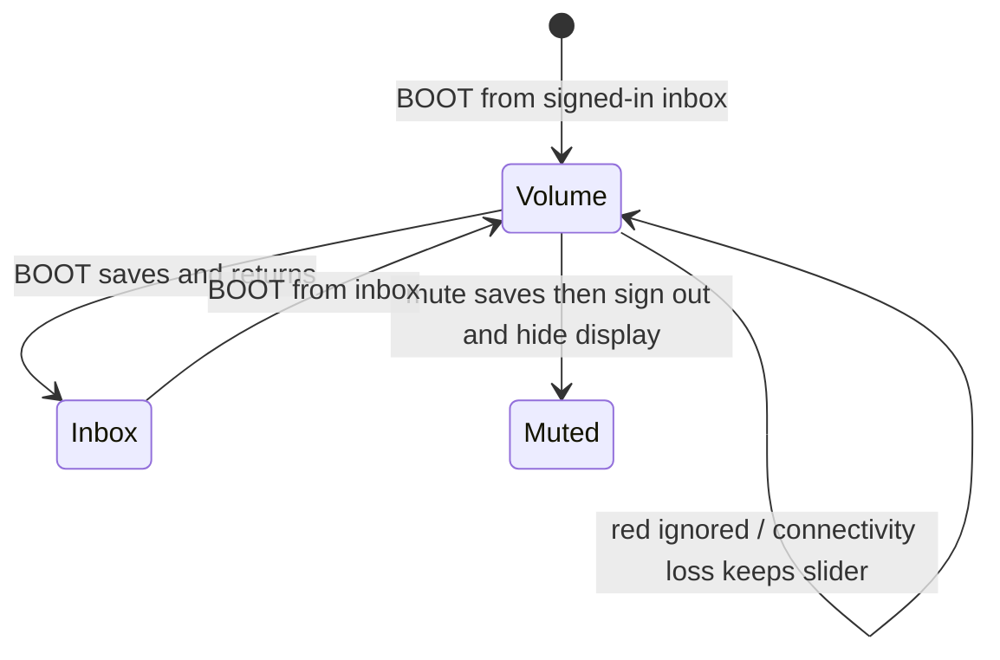

# Settings experience (Volume delivery)

Status: owner-confirmed Volume behavior; contract checkpoint confirmed
2026-10-21; slider visuals and storage mechanism remain follow-on
Experience ID: EXP-SETTINGS
Revision: 0.7
Owner: Product owner
Approval: Volume contract checkpoint confirmed by the owner 2026-10-21; no
firmware implementation authorization implied

## 1. Identity, scope, and authority

This hardware-mediated experience is **only for a signed-in user**. In this
revision it is the Volume screen: the person opens it from the signed-in
message inbox with physical BOOT, adjusts the desk speaker, and returns to
that inbox with BOOT.

A later settings **hub** (logout, user icon, message color, volume) is
named so it is not lost. It is **not** part of this delivery and is not
specified here.

`MUST` expresses a requirement only after its decision is accepted. V1
shoulder-settings behavior is historical and does not establish v2 policy
unless the owner adopts a specific statement.

### Included in this delivery

- Entry from the signed-in message inbox via physical BOOT.
- Split-pane Volume screen: title `Volume`, body volume slider.
- Persist the volume setting when the person leaves this screen via BOOT
  or mute.
- Leave via physical BOOT and return to the message inbox.
- Ignore the red recording button. Keep the Volume slider if connectivity
  drops.

### Excluded from this delivery

- Settings hub and its other controls: logout, user icon, message color.
- User-icon picker, profile editing (including `profile_accent`), and profile save.
- Inbox browsing, playback, recording, and sending internals.
- Login, mute-hardware meaning, and signed-out connectivity (`EXP-LOGIN`).
- Codec registers, slider pixel geometry, and how the saved value is
  stored. The audible stop set is product (`DEC-010`).

### Experience classes

Hardware-mediated. Informational (a local control). Lightly transactional
(the value is saved on leave).

### Sources

| ID | Source and authority | Relevant material |
|---|---|---|
| SRC-OWNER-001 | Product owner, 2026-10-21 first brief | Settings home similar to the v1 product shell; split pane; title-with-subtitle header; four-button body; wait to define destinations; do not deliver until other functionality is defined |
| SRC-OWNER-002 | Product owner, 2026-10-21 correction | Fourth hub control is volume, not “other settings”. This delivery is only Volume: split pane, title `Volume`, volume slider, save on leave, BOOT returns to the message inbox |
| SRC-OWNER-003 | Product owner, 2026-10-21 ordinary-flow interview | Single-line `Volume` header; speaker follows the slider immediately; desk-local persist on BOOT leave; adopt the v1 product-shell stepped range (increments of 2) |
| SRC-OWNER-004 | Product owner, 2026-10-21 exception interview | Mute saves the current stop then signs out to login; red recording button is ignored; connecting / `no Wi-Fi` do not replace the slider |
| SRC-OWNER-005 | Product owner, 2026-10-21 failure interview | First-run default is the loudest stop (100). Persist failure still leaves; keep the current stop until restart; after restart use the last successful save; no error copy |
| SRC-EXP-CAR-001 | Active experience draft; owner-decided for inbox | [`EXP-MESSAGE-CAROUSEL`](message-carousel-and-playback.md): physical BOOT while signed in leaves for settings, pauses playing audio, keeps same-session play heads, stays signed in (`DEC-038`, `EXP-036`). Return path was `OPEN-014` there |
| SRC-EXP-LOGIN-001 | Active experience draft; owner-decided for login | [`EXP-LOGIN`](endpoint-login.md): mute signs out and blanks the display; lower-slot `connecting` / `no Wi-Fi` |
| SRC-UI-SPLIT-001 | Active device-UI draft | [`LAYOUT-SPLIT-PANE`](../device-ui/layouts/LAYOUT-SPLIT-PANE.md); [`PANEL-HEADER-TITLE-LEFT`](../device-ui/panels/PANEL-HEADER-TITLE-LEFT.md); slider track minimum in [`FOUNDATION-DEVICE-CANVAS`](../device-ui/foundations/FOUNDATION-DEVICE-CANVAS.md) |
| SRC-COM-PROFILE-001 | Profile contract; product meaning accepted 2026-10-21 and 2026-10-22 | [User profile](../communication-contracts/user-profile.md): volume stays local; avatar, `profile_accent`, and card background are server profile; core V2 cards use `card_background_id` and do not render `profile_accent` |
| SRC-V1-SET-001 | Historical v1 POC archive; evidence only | Shoulder settings list (not adopted). Desk speaker slider: mute stop, then 78 through 100 inclusive in steps of 2 (13 stops). Defaulted to the maximum stop. Painted the codec number next to the slider (not adopted). BOOT toggled inbox ↔ settings |
| SRC-STD-001 | Normative engineering standard, not product policy | [Client application coding standards](../../standards/client-application-coding-standards.md) |

**Source conflicts and applicability:**

1. The first brief described a four-button settings home and asked to wait
   before defining or delivering it. The owner then replaced that delivery
   with the Volume screen. The four-button home is **future**, not this
   revision (`DEC-001`, `DEC-002`).
2. V1 put volume on a scrolling settings carousel among other cards, and
   used BOOT as an instant toggle. This delivery is a **dedicated Volume
   screen** in the split-pane shell. V1 card order, overlays, autoplay, and
   icon/color pickers are not adopted (`DEC-003`).
3. Device-UI inventory still lists a settings-carousel panel and overlay
   detail. Those wait on a hub that this revision does not deliver.
4. Physical mute still signs the user out (`EXP-LOGIN`). The slider’s silent
   stop is speaker off, not the mute latch.
5. The owner asked to reuse the v1 product-shell volume span and step of
   2. That as-built scale is mute, then 78, 80, … 100. This specification
   adopts those **stops**. It does not adopt v1’s on-screen codec number
   or settings-carousel chrome (`DEC-010`, `DEC-011`).

### Revision history

| Rev | Date | Change |
|---|---|---|
| 0.1 | 2026-10-21 | Reconstruction draft: Volume-only delivery; future hub named; ordinary flow not yet confirmed. |
| 0.2 | 2026-10-21 | Locked title-left `Volume` header, live desk speaker, save on BOOT leave, and the v1 stepped stop set (mute, then 78–100 by 2s). |
| 0.3 | 2026-10-21 | Locked mute-saves-and-signs-out, ignored red button, and keeping the slider through connectivity loss. |
| 0.4 | 2026-10-21 | Locked first-run default 100 and leave-on-persist-failure. Challenge pass recorded. Contract checkpoint pending. |
| 0.5 | 2026-10-21 | Pointed icon/accent/card-background ownership at the profile contract. Volume-only delivery unchanged. |
| 0.6 | 2026-10-21 | Owner confirmed the Volume-only contract checkpoint as written. Slider visuals and storage mechanism remain follow-on. |
| 0.7 | 2026-10-22 | Clarified that profile editing is deferred and core V2 cards do not render `profile_accent`; Volume delivery unchanged. |

## 2. Scenario and intended experience

### Original owner input

First brief, 2026-10-21:

> the settings screen for this experience right now I want to wait to
> define it. This would be similar to the poc-v1 x02 with a split pane
> display. header: title with subtitle panel. body: four button panel
> with: logout; user icon; message color; and other settings. TBD this
> one can remain undefined and not delivered until the other
> functionality is defined.

Correction, 2026-10-21:

> Oh right volume that should be a control in this panel that would be
> the fourth instead of "other settings"
>
> So right now the version of this that I want to deliver is only this.
> split-pane layout. Header: title panel with the word "Volume". Body:
> volume slider. Volume setting is saved when the user leaves the
> screen. The user can leave this screen by pressing the boot button
> that returns to the message inbox

Illustrative names below (Maya, Jordan) are examples, not product data.

### Reconstruction (confirmed 2026-10-21)

- **Person:** A hangout member signed in at the shared desk endpoint
  (example: Maya).
- **Setting:** The same always-on Family Link endpoint as login and
  messages: 320 × 240 landscape touch display, split-pane shell, physical
  BOOT and mute.
- **Goal:** Set how loud this desk plays, then go back to messages.
- **Start:** Maya is on the signed-in message inbox. Physical BOOT pauses
  any playing audio, keeps same-session play heads, stays signed in, and
  opens this experience.
- **First frame:** Split pane. Upper third: single-line title `Volume`,
  no subtitle and no header action. Lower two-thirds: a stepped volume
  slider at the last saved desk value.
- **Ordinary flow:** Maya drags or taps the slider. The desk speaker
  follows immediately. Stops are silent, then 78, 80, … 100. Physical
  BOOT saves that desk value and returns her to the message inbox, still
  signed in. Jordan signing in later on this endpoint hears the same
  level.
- **Completion:** She is finished when she is back on the inbox with the
  volume she left. There is no separate confirmation screen.
- **Future, not this delivery:** A settings hub with four buttons —
  logout, user icon, message color, volume — that would open this Volume
  screen as one destination.
- **Intended qualities, translated to observable behavior:** BOOT is the
  way in and the way out. The screen is only volume. Leaving saves. The
  inbox is where she returns. Loudness uses the short stepped range, not
  a linear 0–100 travel.

## 3. Physical and interaction context

- Display and shell: [`LAYOUT-SPLIT-PANE`](../device-ui/layouts/LAYOUT-SPLIT-PANE.md)
  — upper 80 px, lower 160 px.
- Upper content: [`PANEL-HEADER-TITLE-LEFT`](../device-ui/panels/PANEL-HEADER-TITLE-LEFT.md)
  with copy `Volume`. No subtitle and no header action (`DEC-008`).
- Lower content: a volume slider filling the body. No four-button grid in
  this delivery. The control has **13 stops**: silent, then 78, 80, 82,
  84, 86, 88, 90, 92, 94, 96, 98, 100 (`DEC-010`). Do not show those
  numbers on screen (`DEC-011`). Track thickness must meet
  `fl-slider-track-min` (18–24 px) with a fat knob. Exact length, knob
  size, and snap feel are device-UI/engineering.
- The desk speaker follows the current stop immediately (`DEC-009`).
- Physical BOOT, while this screen is showing, saves the current stop and
  returns to the message inbox (`DEC-006`, `DEC-009`).
- Physical mute still signs out and blanks the display (`EXP-LOGIN`).
  Slider silence is speaker off, not that latch. Mute on this screen also
  saves the current stop (`DEC-012`).
- The physical red recording button is ignored while this screen is
  showing. It does not start sending and does not save (`DEC-013`).
- Connecting or `no Wi-Fi` does not replace the Volume body. The slider
  stays (`DEC-014`).
- Accessibility, localization, and color-blind extras follow login:
  button sizing and visual feedback; screen-reader and touch-less-display
  support are not required; English only.

## 4. Experience model and ordinary journey

| Stage | Entry | Exit | Primary actions | Surviving work |
|---|---|---|---|---|
| Volume | Physical BOOT from the signed-in message inbox | BOOT; mute | Drag or tap the slider among 13 stops. Red is ignored. Connectivity loss does not change the body | Current stop until leave; last saved desk stop after BOOT or mute. Speaker already matches the current stop |
| Message inbox (exit) | BOOT from Volume | Owned by [`EXP-MESSAGE-CAROUSEL`](message-carousel-and-playback.md) | — | Desk volume persisted. Same-session inbox selection and play heads as that spec already requires |
| Muted | Physical mute latch is on | Latch switches off into `EXP-LOGIN` | Display off | No user session. Current stop was saved before sign-out. Unmute is login, not Volume |
| Future hub (not delivered) | Not in this revision | — | — | Named only: logout, user icon, message color, volume |

Ordinary flow: Maya is signed in on messages. She presses BOOT. She sees
the word `Volume` above a slider at this desk’s last saved stop. She
moves the slider; the speaker changes at once to that stop. She presses
BOOT. The endpoint saves that stop for this desk and shows the message
inbox again, still signed in, without autoplaying.

## 5. Stage and operation contracts

### Volume

- **Purpose:** Let the signed-in person set this desk's speaker loudness.
- **Entry:** Physical BOOT from any signed-in stage of the message
  carousel (`EXP-MESSAGE-CAROUSEL` `DEC-038`).
- **Preconditions:** A signed-in session. Inbox playback has already
  paused if it was playing.
- **Inputs present:** The last successfully saved desk volume. If this
  endpoint has never saved a volume, the loudest stop (100) (`DEC-015`).
  After a persist failure in this power-on, the in-memory current stop
  (`DEC-016`).
- **Immediate feedback:** Split-pane Volume screen. Header is
  `PANEL-HEADER-TITLE-LEFT` with copy `Volume`. Body is the 13-stop
  slider at that value. The speaker matches the current stop as soon as
  it changes (`DEC-008`, `DEC-009`, `DEC-010`).
- **Accepted actions:** Change the slider to another stop. Press BOOT to
  save and leave. Mute saves, signs out, and blanks the display.
- **Disabled / ignored:** The red recording button is ignored (`DEC-013`).
  Repeated BOOT after leave is owned by the inbox. Connecting / `no
  Wi-Fi` do not take the lower slot (`DEC-014`).
- **Success / next stage:** BOOT persists the current stop as this
  endpoint’s desk volume, then returns to the message inbox. No “saved”
  toast is specified; leaving **is** the save (`DEC-005`, `DEC-006`,
  `DEC-009`). Mute persists the same stop, then follows login mute
  (`DEC-012`).
- **Failure classes:** If local persist fails on BOOT or mute, still
  leave (inbox on BOOT, login on mute). Keep the current stop for this
  power-on. After restart, restore the last successfully saved stop, or
  100 if none exists. No error copy (`DEC-016`). Connectivity loss is
  not a failure of this screen; the slider stays (`DEC-014`).
- **Timeout / retry:** None. The person may stay indefinitely.
- **Cancellation:** There is no separate cancel. BOOT and mute both save.
  Discard-without-save is not part of this delivery.
- **Background activity:** Inbox last-viewed and other carousel rules
  continue to belong to the inbox spec. This screen does not play inbox
  audio and does not play a preview tone. The new level is heard on the
  next desk audio after she leaves. Server reachability does not change
  this screen’s body.
- **Never-acceptable:** Signing the user out because they pressed BOOT.
  Returning somewhere other than the message inbox on BOOT. Replacing
  the slider with `connecting` or `no Wi-Fi`. Starting a send from the
  red button on this screen. Blocking leave because persist failed.
  Showing a save-failed message. Shipping the four-button hub as this
  delivery. Treating v1 overlay volume as this screen.

### Related mute interruption

Mute on this screen follows `EXP-LOGIN`: display off, user signed out,
endpoint stays powered. Before that, save the current slider stop as
this desk’s volume (`DEC-012`). Unmute presents signed-out login, not
Volume.

## 6. Continuity, data, and side effects

- **Preserved work:** The volume stop at BOOT leave or mute. Inbox
  selection and same-session play heads are preserved by the carousel
  spec, not this one.
- **Local vs remote truth:** Volume is this endpoint’s desk speaker,
  shared by every signed-in user on it. It is not a user-profile field
  (`DEC-009`). Avatar, `profile_accent`, and card background are
  server-owned profile. Core V2 roster and inbox cards use the current
  `card_background_id` and do not render `profile_accent`
  ([user profile](../communication-contracts/user-profile.md)
  `COM-005`–`COM-006`). This Volume screen does not edit them. Future icon
  settings will use the same `avatar_id` catalog as
  [`FOUNDATION-PROFILE-AVATARS`](../device-ui/foundations/FOUNDATION-PROFILE-AVATARS.md).
- **Persistence lifetime:** A successful BOOT or mute save survives later
  visits, other users on this endpoint, and endpoint restart (`DEC-005`,
  `DEC-009`, `DEC-012`). If persist fails, the current stop remains for
  this power-on only; restart restores the last successful save, or 100
  if none exists (`DEC-016`). Unsaved movement is discarded if the
  endpoint loses power before BOOT or mute.
- **Offline:** Setting volume does not require the server. The Volume
  screen stays up with a working slider (`DEC-014`).
- **Duplicates / partial success:** Not applicable; there is no remote
  write in this delivery.
- **Focused item disappearing:** Not applicable; there is no collection.

## 7. Limits and responsiveness

- One volume control on this screen.
- First visit with no successful save: slider and speaker at **100**
  (`DEC-015`).
- **13 discrete stops:** silent (speaker off), then 78, 80, 82, 84, 86,
  88, 90, 92, 94, 96, 98, 100. The slider must not rest between stops.
  Those numbers are the v1 product-shell codec values the owner asked to
  keep; they are not shown on screen (`DEC-010`, `DEC-011`).
- Slider must remain a usable touch target inside the lower slot.
  `fl-slider-track-min` is 18–24 px. Exact length, knob size, and snap
  animation are delegated to device-UI/engineering.
- No product claim is made about codec-register latency until engineering
  measures it. The user-visible rule is: the speaker matches the stop as
  soon as the slider settles on it.
- Concurrent inbox playback is already paused by the carousel exit. This
  screen does not start playback.

## 8. Acceptance scenarios and evidence

Scenarios below cover the locked Volume behavior. Planned verification
only; no evidence pack is claimed.

| ID | Start | Action | Expected | Requirements |
|---|---|---|---|---|
| SCN-001 | Signed in on a non-empty inbox; Maya presses BOOT | Volume screen is shown | Header `Volume`; body is a slider; still signed in; inbox audio is not playing | EXP-001, EXP-002, EXP-003 |
| SCN-002 | Volume screen; Maya changes the slider and presses BOOT | Leave | Value is saved; message inbox is shown; still signed in | EXP-004, EXP-005, EXP-006 |
| SCN-003 | Volume screen; Maya presses BOOT without moving the slider | Leave | Inbox returns; saved value is unchanged | EXP-006 |
| SCN-004 | After SCN-002, Maya presses BOOT from the inbox again | Re-enter Volume | Slider shows the stop saved on the previous leave | EXP-005, EXP-007 |
| SCN-005 | Volume screen; Maya moves the slider | Each settled stop | Speaker matches that stop immediately; header stays `Volume` with no number | EXP-009, EXP-011, EXP-012 |
| SCN-006 | Volume screen at silent; Maya moves one stop up, then continues to the top | Step through the range | Stops are silent, then 78 … 100 by 2s; 13 positions; no in-between values | EXP-011 |
| SCN-007 | Maya saved a stop; Jordan later signs in on this endpoint and opens Volume | Re-enter | Slider and speaker use Maya’s saved desk stop | EXP-010 |
| SCN-008 | Volume screen; Maya moves the slider then latches mute | Mute | Current stop is saved; display off; signed out; unmute shows login, not Volume | EXP-013 |
| SCN-009 | Volume screen; Maya presses the red recording button | Ignore | Stay on Volume; slider unchanged; no send; no extra save | EXP-014 |
| SCN-010 | Volume screen; Wi-Fi or server becomes unavailable | Keep slider | Header stays `Volume`; body stays the slider; she can still change stops and BOOT-save | EXP-015 |
| SCN-011 | Endpoint has never saved a volume; Maya opens Volume | First frame | Slider and speaker are at 100 | EXP-016 |
| SCN-012 | Volume screen; Maya moves to a new stop; persist fails on BOOT | Leave | Inbox is shown; no error copy; speaker stays at the new stop until restart; after restart the previous successful save (or 100) is restored | EXP-017 |

Verification surfaces: the device UI. Planned, not executed. No evidence
pack is claimed.

### Traceability

| Source or decision | Requirements | Stages | Scenarios |
|---|---|---|---|
| SRC-OWNER-002 / DEC-001 | EXP-001 | Volume | SCN-001 |
| SRC-OWNER-002 / DEC-004 | EXP-002, EXP-003 | Volume | SCN-001 |
| SRC-OWNER-002 / DEC-005 | EXP-004, EXP-005 | Volume | SCN-002, SCN-004 |
| SRC-OWNER-002 / DEC-006 | EXP-006 | Volume → inbox | SCN-002, SCN-003 |
| SRC-EXP-CAR-001 / DEC-003 | EXP-001, EXP-008 | Entry from inbox | SCN-001 |
| SRC-OWNER-003 / DEC-008 | EXP-002 | Volume header | SCN-001, SCN-005 |
| SRC-OWNER-003 / DEC-009 | EXP-009, EXP-010 | Volume | SCN-005, SCN-007 |
| SRC-OWNER-003 / DEC-010 / DEC-011 | EXP-011, EXP-012 | Volume | SCN-005, SCN-006 |
| SRC-OWNER-004 / DEC-012 | EXP-013 | Volume → muted | SCN-008 |
| SRC-OWNER-004 / DEC-013 | EXP-014 | Volume | SCN-009 |
| SRC-OWNER-004 / DEC-014 | EXP-015 | Volume | SCN-010 |
| SRC-OWNER-005 / DEC-015 | EXP-016 | Volume | SCN-011 |
| SRC-OWNER-005 / DEC-016 | EXP-017 | Volume → inbox | SCN-012 |
| DEC-002 | — | Future hub (not delivered) | none — named only. Intentionally no requirement in this delivery |

## 9. Decisions, OPEN items, and readiness

### Intent ledger

| ID | Decision | Scope / rationale | Source | Status | Requirements |
|---|---|---|---|---|---|
| DEC-001 | This delivery is only the Volume screen, not the settings hub | Owner: deliver split pane, title `Volume`, slider, save on leave, BOOT back to inbox | SRC-OWNER-002, 2026-10-21 | OWNER-DECIDED | EXP-001 |
| DEC-002 | A later hub’s four controls are logout, user icon, message color, and volume. Volume replaces “other settings”. That hub is not delivered or specified here | Preserves the first brief without shipping it | SRC-OWNER-001 / SRC-OWNER-002, 2026-10-21 | OWNER-DECIDED as naming only | — |
| DEC-003 | Do not adopt v1’s scrolling settings carousel, overlays, autoplay, or icon/color pickers as this screen | This delivery is a dedicated Volume split pane | SRC-OWNER-002 vs SRC-V1-SET-001, 2026-10-21 | OWNER-DECIDED | EXP-001 |
| DEC-004 | Layout is split pane. Header is a title panel showing `Volume`. Body is a volume slider | Owner-stated composition | SRC-OWNER-002, 2026-10-21 | OWNER-DECIDED | EXP-002, EXP-003 |
| DEC-005 | The volume setting is saved when the user leaves the screen | Owner-stated persist rule | SRC-OWNER-002, 2026-10-21 | OWNER-DECIDED | EXP-004, EXP-005 |
| DEC-006 | Physical BOOT leaves Volume and returns to the message inbox | Owner-stated exit. Closes carousel `OPEN-014` for this delivery’s return destination | SRC-OWNER-002 / SRC-EXP-CAR-001, 2026-10-21 | OWNER-DECIDED | EXP-006 |
| DEC-007 | Entry is physical BOOT from the signed-in message inbox, as already required by the carousel spec | Carousel already leaves for settings; this revision’s settings surface is Volume | SRC-EXP-CAR-001, 2026-10-21 | OWNER-DECIDED | EXP-001, EXP-008 |
| DEC-008 | Header is `PANEL-HEADER-TITLE-LEFT` with copy `Volume`. No subtitle. No header action | Leave is BOOT, not Back. Owner accepted the title-only recommendation | SRC-OWNER-003, 2026-10-21 | OWNER-DECIDED; closes OPEN-001 | EXP-002 |
| DEC-009 | The desk speaker follows the slider immediately. BOOT persists that stop as this endpoint’s volume, shared by every user on it, and surviving restart. It is not a user-profile field | Save-on-leave keeps what she just heard. A shared desk has one speaker | SRC-OWNER-003, 2026-10-21 | OWNER-DECIDED; closes OPEN-008 | EXP-004, EXP-005, EXP-009, EXP-010 |
| DEC-010 | Slider stops are silent, then 78, 80, … 100 inclusive in steps of 2 (13 positions). The slider must not rest between stops | Owner asked to reuse the v1 product-shell smaller range and step of 2. Those numbers are the v1 codec stops, kept as the audible scale | SRC-OWNER-003 / SRC-V1-SET-001, 2026-10-21 | OWNER-DECIDED; closes OPEN-003 | EXP-011 |
| DEC-011 | Do not show a numeric level or codec number on this screen | Owner accepted a title-only header. V1 painted the codec number; that label is not adopted | SRC-OWNER-003 vs SRC-V1-SET-001, 2026-10-21 | OWNER-DECIDED | EXP-012 |
| DEC-012 | Mute on Volume saves the current stop, then signs out and blanks the display. Unmute is signed-out login, not Volume | Mute is leaving the desk-volume screen. Owner accepted save-on-mute | SRC-OWNER-004, 2026-10-21 | OWNER-DECIDED; closes OPEN-004 | EXP-013 |
| DEC-013 | The red recording button is ignored on Volume. It does not start sending and is not a save | Send starts from the inbox. BOOT is the Volume leave | SRC-OWNER-004, 2026-10-21 | OWNER-DECIDED; closes OPEN-002 | EXP-014 |
| DEC-014 | Connecting and `no Wi-Fi` do not replace the Volume body. The slider stays usable | Volume is local. Hiding it would block the screen’s only job | SRC-OWNER-004, 2026-10-21 | OWNER-DECIDED; closes OPEN-007 | EXP-015 |
| DEC-015 | If this endpoint has no successful saved volume, the first Volume visit uses the loudest stop (100) | Owner accepted the v1 first-run default so a new desk is audible | SRC-OWNER-005 / SRC-V1-SET-001, 2026-10-21 | OWNER-DECIDED; closes OPEN-005 | EXP-016 |
| DEC-016 | If persist fails on BOOT or mute, still leave. No error copy. Keep the current stop for this power-on. After restart, restore the last successful save, or 100 if none exists | Owner accepted leave-on-failure. Do not trap her on Volume or claim a durable save | SRC-OWNER-005, 2026-10-21 | OWNER-DECIDED; closes OPEN-006 | EXP-017 |

### Requirements

- **EXP-001:** This delivery’s settings experience is the signed-in Volume
  screen. It is not the four-button hub. (`DEC-001`, `DEC-003`)
- **EXP-002:** The screen uses the split-pane shell. The upper panel is
  `PANEL-HEADER-TITLE-LEFT` with copy `Volume`, no subtitle, and no
  header action. (`DEC-004`, `DEC-008`)
- **EXP-003:** The lower panel is a volume slider. (`DEC-004`)
- **EXP-004:** Leaving this screen via BOOT or mute saves the current
  volume stop. (`DEC-005`, `DEC-009`, `DEC-012`)
- **EXP-005:** After a successful save, that stop is what the slider
  shows the next time this screen opens on this endpoint. After a failed
  persist in this power-on, the in-memory current stop is shown instead.
  (`DEC-005`, `DEC-009`, `DEC-016`)
- **EXP-006:** Physical BOOT on this screen returns to the message
  inbox. It does not sign the user out. (`DEC-006`)
- **EXP-007:** Re-entering from the inbox shows the last saved stop
  (`SCN-004`). (`DEC-005`)
- **EXP-008:** Physical BOOT from the signed-in message carousel enters
  this Volume screen and stays signed in. Playing audio is already paused
  by the carousel spec. (`DEC-007`)
- **EXP-009:** While this screen is showing, the desk speaker matches the
  current slider stop as soon as the stop changes. (`DEC-009`)
- **EXP-010:** The saved volume is this endpoint’s desk setting. Another
  user on this endpoint hears and edits the same stop. It is not written
  to the user profile. (`DEC-009`)
- **EXP-011:** The slider has exactly 13 stops: silent, then 78 through
  100 inclusive in steps of 2. It must not rest between stops.
  (`DEC-010`)
- **EXP-012:** This screen does not display a numeric volume or codec
  value. (`DEC-011`)
- **EXP-013:** Mute on this screen saves the current stop, signs the user
  out, and turns the display off. Unmute presents signed-out login, not
  Volume. (`DEC-012`)
- **EXP-014:** The red recording button is ignored while this screen is
  showing. (`DEC-013`)
- **EXP-015:** If Wi-Fi or the server becomes unavailable while this
  screen is showing, keep `Volume` and the slider. Do not show
  `connecting` or `no Wi-Fi` here. (`DEC-014`)
- **EXP-016:** If this endpoint has no successful saved volume, the
  slider and speaker start at 100. (`DEC-015`)
- **EXP-017:** If saving the current stop fails on BOOT or mute, still
  leave with no error copy. Keep that stop until restart. After restart,
  restore the last successful save, or 100 if none exists. (`DEC-016`)

### OPEN items

| ID | Question | Consequence if unresolved | Needed from | Blocks |
|---|---|---|---|---|
| OPEN-001 | *(Resolved 2026-10-21)* Header is `PANEL-HEADER-TITLE-LEFT` with `Volume` (`DEC-008`) | — | — | — |
| OPEN-002 | *(Resolved 2026-10-21)* Red recording button is ignored (`DEC-013`) | — | — | — |
| OPEN-003 | *(Resolved 2026-10-21)* Stop set is mute, then 78–100 by 2s (`DEC-010`). No on-screen number (`DEC-011`) | — | — | — |
| OPEN-004 | *(Resolved 2026-10-21)* Mute saves the current stop then signs out (`DEC-012`) | — | — | — |
| OPEN-005 | *(Resolved 2026-10-21)* First-run default is 100 (`DEC-015`) | — | — | — |
| OPEN-006 | *(Resolved 2026-10-21)* Persist failure still leaves; current stop until restart (`DEC-016`) | — | — | — |
| OPEN-007 | *(Resolved 2026-10-21)* Keep the slider through connectivity loss (`DEC-014`) | — | — | — |
| OPEN-008 | *(Resolved 2026-10-21)* Desk-local shared volume; last saved stop survives restart (`DEC-009`) | — | — | — |

### Locked behavior, variation, and delegation

- **Locked:** Volume-only delivery; split pane; title-left `Volume`;
  13-stop slider (silent, then 78–100 by 2s); no on-screen number; live
  desk speaker; no preview tone; persist on BOOT or mute; BOOT returns
  to the message inbox; mute then login; red ignored; slider kept
  through connectivity loss; first-run 100; persist failure still
  leaves; desk-local shared setting; v1 settings carousel not adopted;
  future hub named and not delivered.
- **Bounded variation:** Slider pixel geometry and snap animation within
  foundation minima and the 13-stop rule. Header must remain `Volume`
  with no Back control. Stage motion may use the shared cover-down
  default unless a later screen spec says otherwise.
- **Delegated:** How the stop is stored; applying the stop to the codec;
  exact slider chrome (track, knob, snap milliseconds) within the
  foundation and 13-stop rule; a later `PANEL-*` for the Volume body.
  Engineering may not change stops, copy, leave/save rules, or add a
  preview tone.

No blocking product OPEN items remain for this Volume delivery. The
future hub is named and out of scope, not an OPEN on this screen.

### Challenge pass (2026-10-21)

- **Ordinary use:** Maya presses BOOT from the inbox, sees `Volume` and
  the 13-stop slider at the last successful save (or 100), moves a stop,
  hears the speaker change for later playback, presses BOOT, and returns
  to the inbox still signed in (`SCN-001`, `SCN-002`, `SCN-005`).
- **Interrupted operation:** She moves the slider then latches mute. The
  stop is saved, the display goes off, and unmute is login (`SCN-008`).
  Red does nothing (`SCN-009`). Offline keeps the slider (`SCN-010`).
- **Failure and recovery:** Persist fails on BOOT. She still reaches the
  inbox with no error copy. This power-on keeps the new stop; a restart
  restores the last successful save (`SCN-012`).
- **Boundary:** Silent is a real stop; 100 is first-run and the top stop
  (`SCN-006`, `SCN-011`). Jordan on this desk shares the saved stop
  (`SCN-007`). Power loss before leave discards unsaved movement.

### Checkpoint and readiness

- **Reconstruction checkpoint:** confirmed 2026-10-21.
- **Ordinary-flow checkpoint:** confirmed 2026-10-21.
- **Exception checkpoint:** confirmed 2026-10-21.
- **Contract checkpoint:** confirmed by the owner on 2026-10-21 as written.
- **Analysis readiness:** ready for the Volume-only delivery, including
  mute, connectivity, first-run, and persist failure. Hub, profile, and
  picker work remain out of scope.
- **Implementation readiness:** behaviorally ready for the Volume-only
  scope. This checkpoint does not authorize firmware implementation.
  Device-UI slider chrome and storage
  mechanism remain engineering/device-UI follow-on within the locked
  rules. No product-wide approval is claimed.

### Review criteria (draft)

| Criterion | Rating | Note |
|---|---|---|
| Concrete | CLEAR | Title-left Volume, 13 stops, BOOT save/return |
| Understandable | CLEAR | Volume in, adjust, leave, mute, ignore red |
| Complete | CLEAR | Ordinary, mute, red, offline, first-run, persist failure recorded |
| Truthful | CLEAR | Speaker follows now; durable save only on successful persist; no fake toast |
| Continuous | CLEAR | Mute saves; red ignored; slider survives connectivity loss |
| Consistent | CLEAR | v1 range/step/default adopted; v1 carousel chrome and codec label not adopted |
| Implementable | CLEAR | Remaining choices are storage, codec apply, and slider pixels within constraints |
| Testable | CLEAR | SCN-001–012 cover ordinary, exception, failure, and boundary |
| Traceable | CLEAR | Owner briefs, v1 evidence, named hub, and resolved OPEN items are distinguished |
| Proportionate | CLEAR | Hub and profile pickers are not specified |

Two implementers should not produce different user-visible Volume
behavior except slider chrome within the 13-stop, no-number, no-preview
constraints. The future hub is permitted to remain unspecified.
